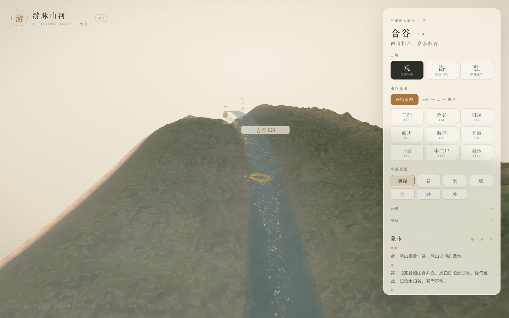

# 游脉山河 · Meridian Drift

> 把身体走成一片山河。

一套以「取象比类」为方法、以微距山水为视觉语言的人体经络动态可视化系统。用户化为一粒气，沿经脉从井穴游到合穴——在**合谷**看见两山相合、众水归谷，在**曲池**看见河道弯折、聚水成池，在**迎香**看见风送香气、气散成光。

**当前状态：M0 原型可运行，M1 体验层进行中。** 合谷段的走廊地形、三境相机、参数面板、气粒子与象卡随巡游已落地。见 [M0 实现说明](docs/04-M0实现说明.md) 与 [M1 增量](docs/06-M1-气与象卡.md)。



---

## 这是什么

今天的经络图把穴位压缩成了编号：合谷是 LI4，曲池是 LI11。编号便于检索，却丢掉了名字里的那幅画。

古人命名穴位，本身就是一次「取象比类」：

- **合谷**：第 1、2 掌骨如山脊并立，虎口凹陷处两山相合，中空为谷。
- **曲池**：屈肘处河道弯折，经气回旋，聚水成池。
- **天鼎**：颈侧高处，三足鼎立，擎天而居。

本项目要做的，是把这些名字重新展开成**可游、可感、可记**的动态场景。

### 核心方法：名 → 象 → 境 → 气 → 用

| 层 | 合谷 | 载体 |
| --- | --- | --- |
| 名 | 合谷（LI4） | 文字、读音、字形 |
| 象 | 两山相合，中空为谷 | 字义拆解 |
| 境 | 双脊夹谷，雾从谷口涌入，水在谷底汇成浅潭 | 地形、天气、植被 |
| 气 | 水汽上升，风穿谷口，粒子在谷底回旋 | 流体、粒子、光影 |
| 用 | 原穴；「面口合谷收」；谷口为关，通于头面 | 象卡、典据、记忆 |

### 三个关键设定

1. **微距山水**：镜头缩小到毫米级，掌骨就是山脉，皮肤就是大地。远看是山水，近看是身体。
2. **以水为脉**：五输是经内的微水文，十二经水是每条经的「大河性格」，子午流注是十二经轮替涨潮。
3. **三境三律**：空间上「观 / 游 / 驻」，时间上「潮 / 流 / 息」，让巡游有节奏，而不是一路特效。

---

## 文档

| 文档 | 内容 |
| --- | --- |
| [设计文档](docs/01-设计文档.md) | 理念、问题、核心创意、设计原则、体验结构、合谷分镜、视觉/声音、交互、伦理、MVP、路线图 |
| [实现架构](docs/02-实现架构.md) | 技术选型、工程结构、数据模型、坐标与身体基座、走廊地形、水文、粒子、渲染、状态机、性能、测试、部署 |
| [取象词典](docs/03-取象词典.md) | 60+ 象元、14 个可调场景原型、构词法、组合规则、同象异境、字义参考、审核清单 |
| [M0 实现说明](docs/04-M0实现说明.md) | M0 范围、模块、关键决策、与架构的偏差、验证结果、已知问题与 M1 计划 |
| [代码目录说明](docs/05-代码目录说明.md) | 目录树、分层依赖、各模块职责、数据流、核心 API、约定与改动指南 |
| [M1 增量：气、象卡与候气](docs/06-M1-气与象卡.md) | 气粒子路径烘焙/着色器、象卡随巡游、候气交互、端头修复与验证 |
| [M1 增量：逐穴巡游](docs/07-M1-逐穴巡游.md) | xstate 状态机、相机停靠、站点导航、测试与取舍 |
| [M1 增量：场景原型](docs/08-M1-场景原型.md) | 六个原型的参数、随经混合、水域差异、预览工具与验证 |
| [M1 增量：Worker 与缓存](docs/09-M1-Worker与缓存.md) | 主线程/Worker 拆分、transferable、IndexedDB 缓存、回退与取舍 |
| [M1 增量：地形墨洗与纸感](docs/10-M1-地形墨洗与纸感.md) | 地形材质的轮廓/皴擦/积墨、纸纹、墨开关与被回退的屏幕空间方案 |
| [M1 增量：二十穴与全身示意](docs/11-M1-二十穴与全身示意.md) | 程序化身体总览、20 穴锚点、颈/头示意、相机与取舍 |
| [M1 增量：前臂段](docs/12-M1-前臂段.md) | 经段切换、LI6–LI11、切平面走廊、前臂相机与取舍 |
| [全身经脉技术方案](docs/13-全身经脉技术方案.md) | BodySurface、SurfaceTile、MeridianGraph、LOD 与实施顺序 |
| [样例数据](content/meridians/hand-yangming-large-intestine.json) | 手阳明大肠经全 20 穴，含象元、原型参数、象卡文本；合谷为深度样例 |

建议阅读顺序：设计文档 → 取象词典 → 实现架构 → 代码目录说明 → M0 实现说明 → M1 增量（06–12）→ 全身技术方案（13）→ 样例数据。

---

## 快速开始

```bash
pnpm install
pnpm dev          # http://127.0.0.1:5173
pnpm build        # 生产构建
pnpm typecheck    # 全仓类型检查
pnpm test         # core + scene-gen 单测
pnpm content:validate   # 校验 content/ 下的经脉内容
pnpm content:build      # 发布模式：任何占位锚点都会失败
pnpm screenshot         # 无头 Chrome 生成 docs/screenshots/*.jpg（需先 pnpm dev）
```

入口支持查询参数，便于复现镜头：

| 参数 | 值 | 说明 |
| --- | --- | --- |
| `mode` | `observe` / `fly` / `dwell` | 三境 |
| `valley` | 0.4–1.8 | 谷深倍率 |
| `river` | 0.5–1.8 | 河宽倍率 |
| `relief` | 0.6–1.4 | 位移倍率 |
| `fog` | 6–34 | 雾密度 |
| `body` | `1` | 显示程序化身体基座 |
| `labels` | `1` | 显示穴位标签（默认关） |
| `qi` | `0` | 关闭气粒子 |
| `archetype` | `auto` / `valley` / `stream` / `gorge` / `pool` / `well` / `pass` | 场景原型（默认 auto，浏览器会记住上次选择） |
| `segment` | `hand` / `forearm` | 经段：手背 LI3–LI5 / 前臂 LI6–LI11 |
| `ui` | `0` | 隐藏界面，用于截图 |

---

## 部署到 GitHub Pages

仓库已带 [`.github/workflows/deploy-pages.yml`](.github/workflows/deploy-pages.yml)，静态产物在 `apps/web/dist`，不需要 Node 服务器。

1. 把仓库推到 GitHub 的 `main` 分支；
2. 仓库 **Settings → Pages → Build and deployment → Source** 选择 **GitHub Actions**；
3. 之后每次 push 会自动执行 `typecheck → test → content:validate → build → deploy`。

访问地址：

- 项目站点：`https://<user>.github.io/<repo>/`（workflow 自动设置 `VITE_BASE=/<repo>/`）
- 用户/组织站点 `<user>.github.io`：自动使用根路径 `/`
- 自定义域名：把 workflow 里 `Compute Pages base path` 一步改成 `/`，或在构建时显式传 `VITE_BASE=/`

页面是单入口、没有前端路由，不需要 404 回退；内容 JSON 在构建期打进 bundle，也不会产生跨域请求。要求浏览器支持 WebGL2，首屏 JS 约 250KB gzip。

本地模拟子路径部署：

```bash
VITE_BASE=/inner-travel/ pnpm build
mkdir -p /tmp/gh-pages/inner-travel
cp -R apps/web/dist/. /tmp/gh-pages/inner-travel/
(cd /tmp/gh-pages && python3 -m http.server 4180)
# 打开 http://127.0.0.1:4180/inner-travel/
```

---

## 技术路线（摘要）

- **身体**：带骨骼的 GLB 基座，穴位以「骨骼帧 + 局部坐标」锚定，运行时投影到体表。
- **地形**：不做全身毫米级网格；只沿当前经脉生成一条 `(s, t)` **走廊地形**，近景 1mm、远景 1cm，其余身体保持低模剪影。
- **高度**：`骨脊 + 肌肉隆起 + 象元特征（谷/脊/潭）+ 经脉下切 + fbm 细节`。
- **水**：汇流累积 + 五输河宽/下切 + 子午流注潮位；不跑完整流体模拟。
- **气**：无状态相位粒子沿预烘焙曲线运动，按原型改变行为（谷地回旋、池面环流、关隘加速）。
- **渲染**：three.js / WebGL2；水墨 + 青绿 + 星图三套皮；景深、墨线、纸纹后处理。
- **内容**：JSON + zod 校验，`content:build` 拒绝占位锚点；预览工具可实时调参。

详见 [实现架构](docs/02-实现架构.md)。

M0 实际使用的是「程序化手 + 前臂」而非 GLB，地形在主线程生成；这些偏差与替换计划记录在 [M0 实现说明](docs/04-M0实现说明.md)。

---

## MVP

**一条经、二十穴、一个深度场景。**

- 经脉：手阳明大肠经（商阳 → 迎香）
- 场景原型：谷、溪、池、井、关、峰等 6 个
- 深度场景：合谷（完整分镜 + 候气交互）
- 平台：桌面 Web，60fps；移动端先支持静态观看

**不做**：十二经全量、VR/AR、账号、社交、AI 问答。

---

## M0 已落地

- **一条经的合谷段**：商阳、三间、合谷、阳溪、曲池五个标定锚点，向心 Catmull-Rom + 弧长参数化。
- **走廊地形**：沿经脉 `(s,t)` 展开的 199×123 网格，含双脊、河谷、合谷汇水潭、五输下切与 fbm/皴法细节；水面由湿边扫描贴合河道。
- **身体基座**：程序化手掌 + 五指 + 前臂（GLB 之前的占位），手背走廊区域让位给地形，可按「身体」开关查看。
- **三境相机**：观（环绕）、游（贴谷飞行）、驻（潭边凝视）；雾、纸纹、墨色地形与青绿水面。
- **参数面板**：谷深、河宽、位移、雾实时可调；合谷象卡与免责声明随场景展示。

验证结果：类型检查、生产构建通过；`content:build` 会因 15 个占位锚点按设计失败。真实 GPU 上的 60fps 尚待目标设备复测（无头 SwiftShader 下为 8–18fps）。

**M1 剩余**：LI1–LI2 手指段与 LI12–LI20 上臂/肩段；带骨骼手部 GLB 与骨骼矩阵锚点；真正的屏幕空间 DOF/墨线。

## M1 已开始

- **气粒子**：沿谷底曲线纹理流动的 3000 个 additive 点，合谷潭心自动加速回旋；「气」图层可关。
- **象卡随巡游**：飞过三间、合谷、阳溪时，面板自动切换当前穴位的字解、象、气与功用。
- **候气**：按住地面，气粒子向指处汇聚，水面起涟漪，地形上浮出两圈光环；松开即散。
- **逐穴巡游**：xstate 驱动的三站巡游，三间 → 合谷 → 阳溪自动停靠，站点可点选跳转。
- **六个场景原型**：谷/溪/峡/池/井/关参数化地形；默认「随经」在三间/合谷/阳溪混合成溪→谷→峡，面板可切固定原型预览。
- **Worker + 缓存**：首屏与参数重建的网格生成都走 Worker，结果缓存到 IndexedDB；记住上次原型，主线程保留旧画面，失败回退主线程。
- **地形墨洗/纸感**：墨只做进地形材质（轮廓/陡坡/积墨），标签与 UI 不受影响；图层可关「墨」。
- **20 穴全身示意**：程序化手臂 + 颈/头，20 个锚点连成经线；图层「全身」或按 `4` 进入总览。
- **前臂段**：新增经段切换，LI6–LI11 六穴有自己的切平面走廊、相机与巡游；目前可游 9 穴。
- 单测增至 31 项（气路径 + 状态机 + 原型 + 纯数据构建 + 20 穴锚点 + 6 站巡游）。

第一周的具体实现顺序见[架构文档 18.4](docs/02-实现架构.md#184-参考实现顺序第一周)；M0 的取舍见 [M0 实现说明](docs/04-M0实现说明.md)，M1 增量见 [气、象卡与候气](docs/06-M1-气与象卡.md)、[逐穴巡游](docs/07-M1-逐穴巡游.md) 、[场景原型](docs/08-M1-场景原型.md)、[Worker 与缓存](docs/09-M1-Worker与缓存.md)、[地形墨洗](docs/10-M1-地形墨洗与纸感.md) 、[二十穴示意](docs/11-M1-二十穴与全身示意.md) 与 [前臂段](docs/12-M1-前臂段.md)。

---

## 边界

本项目是**中医文化展示与教育体验**，不是医疗器械，不提供诊断、治疗或用药建议，不宣称疗效。象卡中的功用描述均限定为「传统理论中的说法」。如有健康问题，请就医。

取象比类是命名与记忆的方法，不是疗效的证据；场景中的山水均为设计演绎，经典原文会单独标注出处。

---

## 目录

```
.
├─ README.md
├─ apps/
│  └─ web/                  # Vite + React + three 场景与界面
├─ packages/
│  ├─ core/                 # schema、锚点、经脉曲线、五输、子午流注（不依赖 three）
│  ├─ scene-gen/            # 走廊网格、高度场、水文、群系（纯数据）
│  └─ render/               # three 材质、身体基座、相机 Rig
├─ content/
│  └─ meridians/
│     └─ hand-yangming-large-intestine.json
├─ tools/
│  └─ content/validate.ts   # 内容校验与发布门禁
├─ scripts/                 # 截图 / 基准脚本
└─ docs/
   ├─ 01-设计文档.md
   ├─ 02-实现架构.md
   ├─ 03-取象词典.md
   ├─ 04-M0实现说明.md
   ├─ 05-代码目录说明.md
   ├─ 06-M1-气与象卡.md
   ├─ 07-M1-逐穴巡游.md
   ├─ 08-M1-场景原型.md
   ├─ 09-M1-Worker与缓存.md
   ├─ 10-M1-地形墨洗与纸感.md
   ├─ 11-M1-二十穴与全身示意.md
   ├─ 12-M1-前臂段.md
   ├─ 13-全身经脉技术方案.md
   └─ screenshots/
```

> 「谷」不是一个比喻，而是一个可以被走进去的地方。
