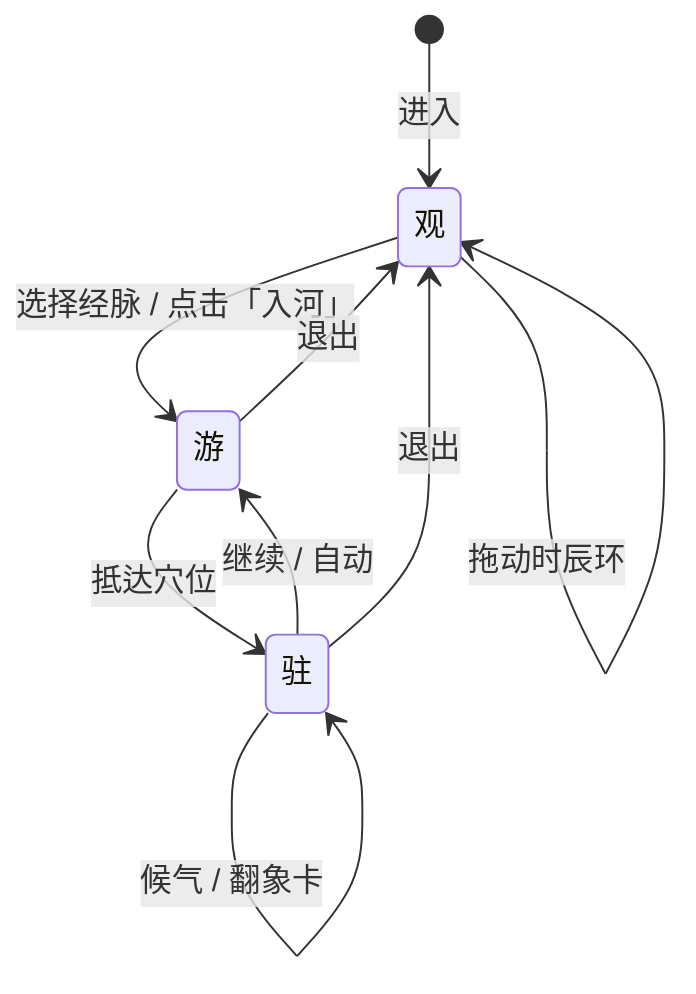

# 游脉山河 · 设计文档

> 把身体走成一片山河。

| 项 | 内容 |
| --- | --- |
| 项目名 | 游脉山河 / Meridian Drift |
| 文档版本 | v0.1（概念设计） |
| 日期 | 2026-11-03 |
| 状态 | 待评审 |
| 关联文档 | [实现架构](./02-实现架构.md) · [取象词典](./03-取象词典.md) · [样例数据](../content/meridians/hand-yangming-large-intestine.json) |

---

## 0. 一句话

**「游脉山河」是一套以「取象比类」为方法、以微距山水为视觉语言的人体经络动态可视化系统：用户化为一粒气，沿经脉从井穴游到合穴，在合谷看见两山相合、众水归谷，在曲池看见河道弯折、聚水成池。**

它不是把经络画得更准，而是把经络**重新读成一片可以走进去的风景**。

### 非目标

- 不是针灸取穴教学软件，不替代教材与临床训练。
- 不是诊断、治疗或疗效展示工具。
- 不是解剖学图谱，不追求医学影像级精度。
- 不是游戏，不设任务、积分、对战。

---

## 1. 问题：名字里的那幅画，在数字化时丢了

今天的经络可视化大致有三种范式：

| 范式 | 代表 | 优点 | 丢失的东西 |
| --- | --- | --- | --- |
| 解剖图示 | 经络挂图、3D 人体模型 | 位置准确 | 穴名的意象、经气的时间性 |
| 流动动画 | 光点沿线路移动 | 有方向感 | 光点为什么这样流、此处为何叫这个名 |
| 游戏化 | 经络闯关、穴位消除 | 易上手 | 医理与文化厚度 |

三者共同的缺口是：**穴位名称被压缩成了编号**。

合谷成了 LI4，曲池成了 LI11，天鼎成了 LI17。编号便于检索，却切断了名字与身体经验之间的通路。而古人命名穴位，恰恰是在做一次精密的「取象比类」：

- **合谷**：第 1、2 掌骨如山脊并立，虎口凹陷处两山相合，中空为谷。
- **曲池**：屈肘处河道弯折，经气回旋，聚水成池。
- **天鼎**：颈侧高处，三足鼎立，擎天而居。
- **迎香**：鼻旁，风送香气，气之所迎。

每一个名字都是一幅画、一个位置、一种气机。**名字本身就是一张地图。** 本项目要做的，是把这张地图重新展开成可游、可感、可记的动态场景。

### 1.1 取象比类不是修辞，是认知方法

「取象比类」出自《周易》的观物取象传统，在中医里被用作组织身体经验的核心方法：

1. **观物取象**：观察自然与人体的可感形态，提取「象」。
2. **比类**：按位置、性质、功能，把未知归入已知的类别。
3. **以象尽意**：用可感的形象承载不可直接言说的关系。
4. **天人相应**：把身体放回天地、四时、山泽的秩序中理解。

《灵枢·经水》直接把十二经脉比作十二條古水：

> 「经脉十二者，外合于十二经水，而内属于五藏六腑。」
>
> 「经水者，受水而行之……经脉者，受血而营之。」

这不是文学修饰，而是古人理解经脉运行的一套**模型**。本项目要做的，是把这套模型翻译成当代媒介可以承载的**空间经验**。

### 1.2 为什么必须是动态的

经络的核心不是一条线，而是**时间中的流动**：

- 十二经在十二时辰里轮替「涨潮」（子午流注）。
- 一条经内部，气从井穴出、经荥输经、最终入于合穴。
- 一个穴位处，气有聚散、开阖、升降。

静态模型只能呈现「在哪里」，动态系统才能呈现「何时、为何、如何」。所以本项目的第一性对象不是「经络图」，而是**一场持续运行的水文系统**。

### 1.3 目标用户与使用场景

| 用户 | 核心诉求 | 系统回应 |
| --- | --- | --- |
| 中医学生 / 初学者 | 记不住穴名、定位与归经 | 名—象—境绑定；象卡；可切回「体」看定位 |
| 中医文化爱好者 | 想要一次美的、可沉浸的体验 | 微距山水；声音；长卷式巡游 |
| 教师 / 讲者 | 课堂演示，能随时跳转 | 自由巡游；体/境切换；大屏模式 |
| 设计师 / 研究者 | 理解「取象比类」的方法 | 取象词典；参数可调；场景可导出 |

**典型场景**：

- **自学**：睡前 15 分钟，走一条经，记住三个穴名。
- **课堂**：5 分钟演示合谷，从「体」切到「境」，再切回。
- **展览**：无人值守循环巡游，观众可触碰时辰环。
- **创作**：设计师用词典与预览工具，为新的穴位调制场景。

---

## 2. 核心创意

### 2.1 微距山水：尺度即隐喻

把镜头缩小到毫米级，人体就自然变成了地貌：

| 身体 | 山水 |
| --- | --- |
| 掌骨、指节 | 山脉、丘陵 |
| 皮肤沟壑、肌腱 | 峡谷、峡江 |
| 汗毛、毛孔 | 林木、孔窍 |
| 皮肤纹理 | 岩层、皴法 |
| 组织液、水汽 | 溪流、云雾 |
| 穴位 | 地名、关隘、渡口 |

**远看是山水，近看是身体。** 这种「双象」不是滤镜，而是尺度转换带来的真实知觉：当相机只有一粒气那么大，合谷的凹陷就真的是一个谷地，两侧的掌骨就真的是两座山。

> 设计判断：不做「人体上叠加山水特效」，而是让**同一张皮肤表面同时承担解剖与地貌两种读法**。解剖保证可信，地貌保证可感。
>
> 需要说明：地形的高低是**艺术夸张**，幅度可达数毫米至一厘米，并不表示皮肤的真实起伏；穴位位置与归经保持准确，场景只改变「读法」，不改变「位置」。

### 2.2 以水为脉：三套水文学

「水」是本项目的统一材质，也是三套时间尺度的交点。

**（1）五输：一条经内部的微水文**

《灵枢·九针十二原》：

> 「所出为井，所溜为荥，所注为输，所行为经，所入为合。」

| 五输 | 水形态 | 身体位置 | 动态特征 |
| --- | --- | --- | --- |
| 井 | 石隙初涌 | 指/趾端 | 细、弱、源头感，向上冒 |
| 荥 | 浅溪漫石 | 掌指/跖趾关节前 | 涓涓、分叉、透明 |
| 输 | 溪流汇注 | 关节后 | 渐宽、有滩、开始有岸 |
| 经 | 河渠正流 | 腕踝附近 | 稳定、有流速、有航道 |
| 合 | 百川归海 | 肘膝附近 | 深、缓、回旋、聚成潭 |

**（2）十二经水：一条经对应一条古水**

| 经脉 | 经水 | 经脉 | 经水 |
| --- | --- | --- | --- |
| 足太阳膀胱经 | 清水 | 手太阳小肠经 | 淮水 |
| 足少阳胆经 | 渭水 | 手少阳三焦经 | 漯水 |
| 足阳明胃经 | 海水 | 手阳明大肠经 | 江水 |
| 足太阴脾经 | 湖水 | 手太阴肺经 | 河水 |
| 足少阴肾经 | 汝水 | 手少阴心经 | 济水 |
| 足厥阴肝经 | 渑水 | 手厥阴心包经 | 漳水 |

出处：《灵枢·经水》。这张表给每条经一个「大河性格」：江水浩荡、河水浑厚、济水清深、海水辽阔。合谷在**手阳明大肠经**上，所以它属于「江水」流域——一个在长江水系里、由两座掌骨山夹出的谷地。

**（3）子午流注：十二经轮替涨潮**

十二时辰对应十二经，每两小时一条经当令：

> 肺寅大卯胃辰宫，脾巳心午小未中，申膀酉肾心包戌，亥焦子胆丑肝通。

当令之经水位上涨、雾气加重、粒子变密；非当令之经退为细流。用户看到的不是十二条同时发光的线，而是**一条正在涨潮的河，和十一条安静的河**。这直接对应「气血流注」的时间观。

### 2.3 名 → 象 → 境 → 气 → 用

这是本项目的内容生产管线，也是用户的理解路径。

| 层 | 合谷的例子 | 载体 |
| --- | --- | --- |
| **名** | 合谷（LI4） | 文字、读音、字形 |
| **象** | 两山相合，中空为谷 | 字义拆解、意象描述 |
| **境** | 双脊夹谷，雾从谷口涌入，水在谷底汇成浅潭 | 地形、天气、植被、声音 |
| **气** | 水汽上升，风穿谷口，粒子在谷底回旋 | 流体、粒子、光影、节奏 |
| **用** | 原穴；四总穴「面口合谷收」；谷口为关，通于头面 | 象卡、典据、记忆锚点 |

设计上要求：**每一层都能单独关闭，但默认叠合呈现。** 用户可以先看景，再看字；也可以先读典，再入景。理解顺序不被系统强制。

### 2.4 三境三律

**空间三境**：

- **观**（天）：全身或半身尺度，十二经如银河，时辰环在上方。
- **游**（游）：一条经的尺度，镜头贴地飞行，气随水走。
- **驻**（驻）：一个穴位的尺度，环绕、凝视、候气。

**时间三律**：

- **潮**：十二时辰的经水涨落，周期 24 小时。
- **流**：一条经从井到合的行进，约 3–8 分钟。
- **息**：在一个穴位停留，约 20–40 秒，一呼一吸为一息。

「巡游」的节奏，就是在这三种时间之间切换：**潮决定去哪条河，流决定怎么走，息决定在哪里停。**

---

## 3. 设计原则

1. **象不离体**
   任何山水都必须能对应回真实的解剖位置。界面永远保留一个「体/境」滑杆：向左是身体，向右是山水，中间是双象。用户不会因为好看而失去位置感。

2. **因名立象**
   场景首先从穴名生长出来，而不是先做一套通用地形再贴标签。先有「谷」，才有谷地；先有「池」，才有深潭。

3. **同象异境**
   同一个字在不同穴位要长出不同的景。合谷的谷、阴谷的谷、然谷的谷，字同而地气不同。避免「一个模板套所有谷」。

4. **一线贯穿**
   镜头与气共用同一条路径，不切镜头、不跳场景。巡游必须是一口气走完的，像展开一幅长卷。

5. **动静有节**
   不是全程高能。井穴慢、经穴快、合穴慢；谷地停、平原过。留白与静默是节奏的一部分。

6. **留白胜满**
   宁可少画一座山，不多放一个特效。默认画面应像宋人山水：大量空、少量实、一处亮。

7. **典出有据**
   每个场景至少有一条经典依据或明确的命名逻辑。象卡里区分「原文」「今释」「设计演绎」三种文本，不混为一谈。

8. **不越医界**
   只做文化、教育、审美体验。不宣称疗效，不给出诊断，不替代专业医疗建议。

---

## 4. 体验结构

### 4.1 一次巡游的骨架



- **自动巡游**：系统按经序推进，适合第一次体验。
- **自由巡游**：用户可随时停下、环顾、跳穴、改时辰。
- **时辰漫游**：拖动时辰环，看十二条河依次涨潮，不进入单经。

### 4.2 手阳明大肠经 · 巡游脚本

从食指商阳到鼻旁迎香，一条「江水」从指尖流向面颊。

| 序 | 穴 | 身份 | 字象 | 场景一句话 | 节奏 |
| --- | --- | --- | --- | --- | --- |
| 1 | 商阳 | 井金 | 商·阳 | 指尖尽头的向阳石隙，一线泉水初出 | 慢 |
| 2 | 二间 | 荥水 | 间 | 指节前的石缝浅溪，水声细碎 | 慢 |
| 3 | 三间 | 输木 | 间 | 掌指关节后的碎石滩，溪水散开 | 缓 |
| 4 | **合谷** | **原** | **合·谷** | **两掌骨如山，虎口成谷，雾聚水汇** | **最慢** |
| 5 | 阳溪 | 经火 | 阳·溪 | 腕间两筋如峡，阳光碎在水面 | 中 |
| 6 | 偏历 | 络 | 偏·历 | 偏离主道的渡口，水声分叉 | 中 |
| 7 | 温溜 | 郄 | 温·溜 | 前臂缓流，水汽带暖 | 中 |
| 8 | 下廉 | — | 廉 | 前臂下缘的崖线，风从崖下过 | 快 |
| 9 | 上廉 | — | 廉 | 前臂上缘的崖线，云在崖上走 | 快 |
| 10 | 手三里 | — | 里 | 河湾边的驿站，一盏灯 | 中 |
| 11 | **曲池** | **合土** | **曲·池** | **肘弯大河回旋，聚成深池，水面如镜** | **最慢** |
| 12 | 肘髎 | — | 髎 | 肘骨缝隙，暗泉 | 中 |
| 13 | 手五里 | — | 里 | 上臂的里程碑，路标 | 快 |
| 14 | 臂臑 | — | 臑 | 上臂软肉如草甸，风低草伏 | 中 |
| 15 | 肩髃 | — | 髃 | 肩峰转角，风大，云被撕开 | 中 |
| 16 | 巨骨 | — | 巨·骨 | 锁骨与肩胛之间的巨石阵 | 慢 |
| 17 | 天鼎 | — | 天·鼎 | 颈侧高处的三足鼎，云气环绕 | 慢 |
| 18 | 扶突 | — | 扶·突 | 扶持而起的孤峰与关隘 | 中 |
| 19 | 口禾髎 | — | 禾·髎 | 鼻旁谷地，禾田与孔窍 | 中 |
| 20 | **迎香** | — | **迎·香** | **面颊崖畔的花径，风送香气，气散成光** | **慢** |

三个「最慢」是整条经的三个华彩段：**合谷（谷）、曲池（池）、迎香（散）**。其余为过渡，快慢相间，形成呼吸。

### 4.3 合谷 · 分镜脚本（深度场景）

**场景目标**：让用户在一个穴位里同时感到「两山相合」「众水归谷」「气聚不散」三件事，并记住「面口合谷收」。

| 时间 | 镜头 | 画面 | 声音 | 文字 | 交互 |
| --- | --- | --- | --- | --- | --- |
| 0:00–0:08 | 贴皮飞行，低空 | 手背如赭色山脉，两列掌骨如双脊，雾在脊间流动 | 风声，远处水声 | 角落浮出「手阳明大肠经 · 江水」 | 可拖拽环顾 |
| 0:08–0:18 | 俯冲入谷，速度渐慢 | 谷口收窄，两壁逼近，天光变成一线 | 风声变窄，水声渐近 | — | — |
| 0:18–0:28 | 谷底悬停，缓慢环绕 | 浅潭、卵石、水汽上升；粒子从两脊向谷底汇入 | 水声、低频 | 一枚朱印浮现：「合谷」 | — |
| 0:28–0:40 | 环绕 + 微推 | 潭面倒映天光；风穿过谷口，水面起皱 | 磬声一记 | 象卡展开：名 / 字解 / 象 | 可翻页 |
| 0:40–0:55 | 固定，微微呼吸 | 粒子在谷底聚成旋涡，又散开 | 低频渐强 | 高亮「原穴」；「面口合谷收」 | 按住「候气」触发涟漪 |
| 0:55–1:05 | 拉升，回望谷口 | 谷地缩小成掌背上的一个凹处，双象切换 | 风渐远 | 「继续上行 → 阳溪」 | 点击继续 |

**双象时刻**：最后 10 秒，镜头拉远，山水渐隐、皮肤纹理渐显，用户看到「刚才的谷地，其实就在自己的手背上」。这是整个体验的「啊哈」时刻，也是取象比类的完成：**象与体，在此合一。**

### 4.4 自由巡游的边界

- 用户可以在经上任意点停留，但不能离开体表。
- 可以拖动时辰环改变「潮」，但不会改变当前位置。
- 可以打开「体」模式，看到解剖标注与穴位定位；此时山水退为半透明。
- 可以一键「随流而行」，让系统接管镜头。

### 4.5 首次体验的 20 分钟

| 时间 | 用户状态 | 系统动作 |
| --- | --- | --- |
| 0:00–0:15 | 看到身体与十二条暗河，不知从哪进 | 默认高亮当令经；一行字：「此刻，大肠经正在涨潮」 |
| 0:15–0:40 | 好奇，点击「入河」 | 镜头下潜；一粒气出现；提示「跟着它走」 |
| 0:40–3:00 | 跟随，经过三间、合谷 | 在合谷自动减速；象卡展开；提示「按住，候气」 |
| 3:00–8:00 | 走完一条经，到迎香 | 气散成光；回望；「再走一条？」 |
| 8:00–20:00 | 自由探索 | 时辰环、跳穴、体/境滑杆、换经 |

前 15 秒不要求用户做任何选择——**先让画面自己说话**。所有教学性文字都在用户产生动作之后出现。

---

## 5. 取象系统

> 完整词典、象元表与组合规则见 [03-取象词典](./03-取象词典.md)。本节只讲设计层。

### 5.1 象元：命名的最小单位

穴名可拆成若干「象元」。象元分六类：

| 类 | 例字 | 指向 |
| --- | --- | --- |
| 水文 | 井、泉、溪、沟、溜、池、泽、渊、海、渎、渠、渚 | 气的出入、聚散、深浅 |
| 地貌 | 谷、山、陵、丘、墟、冈、冢、原、野、突、崖 | 身体的起伏与围合 |
| 关隘 | 门、户、窗、关、阙、枢、机、堂、庭、府、舍 | 气的出入通道与居所 |
| 天象 | 天、星、辰、月、日、云、风、雷 | 位置的高下与天气 |
| 器物 | 鼎、钟、鼓、玉、珠 | 形制、重量、声 |
| 生物 | 禾、竹、龟、鱼、鹤、燕、鸠 | 生机、季节、动静 |

### 5.2 从象元到场景原型

每个象元映射到一个**场景原型**（archetype），原型只定义「地形语法」，具体形态由参数、身体位置、经脉属性共同决定。

| 象元 | 原型 | 核心地形 | 默认气氛 |
| --- | --- | --- | --- |
| 谷 | valley | 双脊夹一谷，谷底有汇水 | 雾、风、回声 |
| 池 | pool | 河道弯折处的深潭 | 静水、倒影、暖光 |
| 溪 | stream | 浅槽、卵石、分叉 | 碎光、清响 |
| 井/泉 | well | 石隙、竖井、上涌 | 幽暗、滴水、一线天 |
| 海/泽 | sea | 开阔水面、远岸 | 辽阔、低平、潮声 |
| 门/关/阙 | pass | 两柱或两崖之间的隘口 | 风穿、回声、关楼 |
| 山/陵/丘 | peak | 隆起、山脊、崖壁 | 高风、云海 |
| 髎/孔/窍 | cave | 骨缝、孔洞、内腔 | 潮湿、暗泉 |
| 天/星/辰 | sky | 高台、穹顶、星野 | 夜、寒、光 |
| 鼎/钟/鼓 | vessel | 器物化的地景 | 金属声、重量 |
| 里/市 | station | 河湾、驿站、村落 | 灯火、人烟 |
| 禾/竹 | flora | 田畴、竹林 | 风过、叶响 |

> 上表为常见原型；完整列表与参数见[取象词典第 4 节](./03-取象词典.md#4-场景原型参数表)。

### 5.3 组合规则

一个穴名往往由两个象元叠加，例如「合谷」= 合（围合）+ 谷（低地）。系统用一组规则做合成：

- **R1 字解**：先按古汉语义拆字，不按现代汉语。
- **R2 主从**：末字常为主象（谷、池、溪），首字为修饰（合、曲、温、迎）。
- **R3 围合增强**：合、曲、环、关 → 提高地形围合度与回声。
- **R4 方向修饰**：阴/阳、上/下、内/外 → 改变光照、坡向、湿度。
- **R5 时间修饰**：温、热、清、凉 → 改变水温、雾密度、色温。
- **R6 五输定流**：井/荥/输/经/合 决定水的形态与速度。
- **R7 经脉定色**：经脉五行决定主色、水质、植被。
- **R8 体位定势**：手/足、伸/屈、骨/肉，决定山谷的朝向与尺度。

### 5.4 同象异境：四个「谷」

同名之字，必须长出不同的景，否则取象就退化成贴图。

| 穴 | 经脉 | 位置 | 五输/身份 | 场景差异 |
| --- | --- | --- | --- | --- |
| **合谷** | 手阳明（金） | 手背，两掌骨间 | 原 | 开阔谷地，风穿谷口，水汇成浅潭；明亮、干爽 |
| **阴谷** | 足少阴（水） | 膝腘，筋间 | 合 | 深谷幽泉，寒气重，水色玄；光只落在水面一线 |
| **然谷** | 足少阴（水） | 足内侧，舟骨下 | 荥 | 谷中石隙，泉从石出，苔藓；细小而活 |
| **阳谷** | 手太阳（火） | 腕背，尺骨茎突前 | 经 | 向阳谷口，日光斜切，水浅而急；暖色 |

四条经、四个位置、四种五行，同一个「谷」字因此有四种天气。**象同而境异，这是系统是否成立的关键检验。**

### 5.5 象的边界

取象比类是**命名与记忆的方法**，不是疗效的证据。项目中：

- 所有「主治/功用」文本均标注为「传统理论」，并附免责声明。
- 不用「治疗」「治愈」「有效率」等词。
- 不把视觉隐喻（如「谷地聚气」）说成生理机制。
- 经典原文与设计演绎在排版上明确区分（原文用引文样式，演绎用斜体/不同底色）。

---

## 6. 视觉与声音

### 6.1 三套皮，按时辰切换

| 模式 | 视觉 | 适用时辰 | 气质 |
| --- | --- | --- | --- |
| **青绿** | 石青、石绿、赭石、泥金；山体有皴法 | 卯—申（白天） | 宋人青绿山水，明丽 |
| **水墨** | 墨分五色、大量留白、湿边扩散 | 酉—寅（夜/晨） | 文人水墨，静 |
| **星图** | 深靛、银白、经络如银河、穴位如星 | 子时前后 | 天文图，远 |

切换不是硬切，而是随时辰连续插值；用户也可手动锁定。

### 6.2 色彩

以中国传统色为基，避免高饱和霓虹：

| 五行 | 主色 | 辅色 | 用法 |
| --- | --- | --- | --- |
| 木 | 石绿 `#6E8B6A` | 青 `#4A7C8C` | 肝胆经、植被 |
| 火 | 朱砂 `#B23A2E` | 绛 `#7E2F2A` | 心、小肠、心包 |
| 土 | 藤黄 `#C9A227` | 赭 `#A9714B` | 脾胃、土坡 |
| 金 | 蛤白 `#E8E3D5` | 金 `#B08A4F` | 肺、大肠、石 |
| 水 | 玄 `#1C2430` | 黛 `#2B3A4A` | 肾、膀胱、深水 |

经脉识别不能只靠颜色：每条经另有**线型/纹理**（实线、虚线、点线、双线）与**字形徽记**，保证色盲友好。

### 6.3 字体与版式

- 穴名：楷体（如霞鹜文楷），竖排，带朱印。
- 正文：宋体（如思源宋体），横排，行距疏朗。
- 数字与编号：等宽衬线，弱化。
- 版式：右侧竖卷轴式象卡，左上角经名，底部极简进度线。**不出现科幻 HUD、扫描线、六边形网格。**

### 6.4 运动

- 镜头：缓入缓出，无抖动；转弯有轻微侧倾（不超过 3°）。
- 水：以「呼吸」为节奏，周期 4–6 秒。
- 粒子：不追求高速，追求「聚—散—再聚」的循环。
- 转场：以雾气、水面、墨色扩散完成，不用白闪/黑场。
- 尊重 `prefers-reduced-motion`：关闭镜头自动移动，改为静态环绕 + 手动。

### 6.5 声音

三层，默认轻：

1. **水**：按流速与落差滤波的白噪声；谷地加回声，池面加低频。
2. **风**：按海拔与围合度调节；关隘处有窄带啸音。
3. **磬/钟**：抵达穴位时一记，音高按五行五音（角、徵、宫、商、羽）映射。

声音默认在用户首次交互后启动（浏览器自动播放限制）。提供独立音量与静音。

---

## 7. 界面与交互

### 7.1 界面层级

```
┌────────────────────────────────────────────┐
│  手阳明大肠经 · 江水            时辰环 ○    │
│                                            │
│                                            │
│               [ 场 景 ]                    │
│                                            │
│                              ┌──────────┐  │
│                              │  象 卡    │  │
│                              │  合谷     │  │
│                              │  字解…    │  │
│                              │  象…      │  │
│                              │  气…      │  │
│                              │  典…      │  │
│                              └──────────┘  │
│  商阳 ─────●───── 曲池 ────── 迎香          │
│        进度 / 穴位刻度                      │
└────────────────────────────────────────────┘
```

### 7.2 象卡

象卡是一张「可翻的竖卷」，不是信息面板。字段：

| 字段 | 内容 | 排版 |
| --- | --- | --- |
| 穴名 | 合谷 / Hégǔ / LI4 | 楷体大字 + 朱印 |
| 字解 | 合，两山相合；谷，两山之间的低地 | 小字，逐字拆解 |
| 象 | 两掌骨如山，虎口成谷；经气至此，如众水归谷 | 正文 |
| 气 | 原穴。谷为风道，亦为隘口；气聚于谷，能开能阖 | 正文 |
| 用 | 传统用于头面五官、发热、疼痛；「面口合谷收」 | 小字 + 标签「传统理论」 |
| 典 | 《灵枢·本输》《四总穴歌》 | 折叠，引文样式 |
| 免责 | 文化展示，非医疗建议 | 页脚，常驻 |

翻页交互：上滑看下一段，或点击「典」展开原文。**不做长滚动信息流。**

### 7.3 操作

| 动作 | 桌面 | 移动 |
| --- | --- | --- |
| 环顾 | 拖拽 / 方向键 | 单指拖动 |
| 前进/后退 | 滚轮 / W·S | 双指上下 |
| 停留/继续 | 空格 | 轻点底部 |
| 候气 | 按住鼠标 / 长按 | 长按 |
| 切体/境 | `Tab` / 滑杆 | 底部滑杆 |
| 开象卡 | `E` / 点击穴位 | 点击穴位 |
| 时辰 | 拖动时辰环 | 拖动时辰环 |

### 7.4 无障碍

- 全部场景提供文字替代（「场景描述」段落）。
- 色盲友好：颜色 + 线型 + 徽记三重编码。
- 键盘可完成全部核心操作。
- 动态强度可调；提供「静态长卷」模式（2.5D，无镜头运动）。
- 光敏安全：无高频闪烁；粒子亮度变化 < 3 Hz。
- 字幕/文本可放大至 200%。

---

## 8. 内容规范

### 8.1 文案语气

- **简**：一句一景，不堆形容词。
- **准**：位置、归经、五输、特定穴必须准确。
- **有画面**：优先动词与空间词，少用抽象名词。
- **不神棍**：不用「能量场」「磁场」「量子」等伪科学话术。
- **不西医化**：不强行用神经、筋膜解释；如需对照，另设「今释」小节并标注。

### 8.2 三层文本

每张象卡区分：

1. **原文**：经典引文，注明出处与篇名。
2. **今释**：现代汉语解释，可引用学术共识。
3. **设计演绎**：为场景服务的艺术想象，明确标注「设计演绎」。

三者不混排。用户应能一眼看出哪句是古人说的，哪句是我们编的。

### 8.3 审校流程

1. **医理审**：穴位定位、归经、五输、特定穴、流注时辰。
2. **文献审**：引文核对原书，版本注明。
3. **文案审**：语气统一，去疗效化，去神秘化。
4. **视觉审**：场景是否真的从字义长出来，而非通用特效。

### 8.4 数据与内容分离

所有穴位文本、象元、场景参数存于 `content/`，不写死在代码里。新增一条经、一个穴，不需要改引擎。

---

## 9. 伦理与边界

- **非医疗器械**：本项目不构成医疗器械，不提供诊断、治疗、用药建议。
- **不宣称疗效**：所有功用描述限定为「传统理论中的说法」，并提示「如有健康问题请就医」。
- **不替代专业训练**：定位与操作以文字/示意为主，不提供针刺教学。
- **文化尊重**：避免猎奇化、玄幻化；引用注明出处；对存在学术争议的内容标注「有争议」。
- **数据最小化**：不收集健康数据；分析仅匿名行为事件，可退出。
- **内容可更正**：建立勘误入口，版本化发布。

---

## 10. MVP 与路线图

### 10.1 MVP 范围（P0）

**一条经、二十穴、一个深度场景。**

| 维度 | 范围 |
| --- | --- |
| 经脉 | 手阳明大肠经（20 穴） |
| 身体 | 右手 + 前臂 + 上臂 + 肩颈 + 面部的简化模型 |
| 场景原型 | 谷、溪、池、井、关、峰（6 个） |
| 深度场景 | 合谷（完整分镜 + 候气交互） |
| 时间 | 单经巡游 + 穴位停留；子午流注仅做高亮，不做全经涨潮 |
| 视觉 | 青绿一档；水墨做静态后处理实验 |
| 声音 | 水/风两层，磬声可选 |
| 平台 | 桌面 Web（Chrome/Safari/Edge），移动端可看不可游 |
| 性能 | 桌面 60fps，加载 < 5s |

**MVP 不做**：十二经全量、VR/AR、用户账号、社交分享、AI 问答、四时变化。

### 10.2 路线图

| 阶段 | 周期 | 目标 | 关键交付 |
| --- | --- | --- | --- |
| **M0 立象** | 2 周 | 证明「微距山水 + 合谷」成立 | 单场景 Demo：合谷谷地、可环绕、雾与水 |
| **M1 成经** | 4 周 | 走完一条经 | 20 穴、巡游状态机、象卡、6 原型 |
| **M2 十二经** | 8 周 | 全身经络与时间系统 | 12 经、子午流注涨潮、时辰环、全身体表 |
| **M3 自由与分享** | 4 周 | 可漫游、可传播 | 自由巡游、URL 分享、截图卡片、移动端 |
| **M4 深境** | 持续 | 内容与体验深化 | 四时、体质、更多原型、音频、无障碍完善 |

### 10.3 为什么先做手阳明大肠经

1. 合谷是最能说明「取象比类」的穴位，也是四总穴之一，认知度高。
2. 手臂几何相对简单，微距地形可控，适合验证技术路线。
3. 一条经从指端到面部，地形变化丰富：指尖—掌—腕—前臂—肘—上臂—肩—颈—面，几乎覆盖所有原型。
4. 「江水」的意象明确，便于建立整条经的统一气质。

---

## 11. 成功指标

| 类型 | 指标 | 目标（M3） |
| --- | --- | --- |
| 完成度 | 开始巡游后走完一条经 | ≥ 55% |
| 深度 | 单次停留合谷 ≥ 60 秒 | ≥ 40% |
| 学习 | 完成后能说出 3 个穴名的字义 | ≥ 60%（可用小测） |
| 回访 | 7 日内再次打开 | ≥ 20% |
| 传播 | 主动分享/截图 | ≥ 5% |
| 性能 | 桌面 P95 帧时间 | ≤ 20ms |
| 可访问 | 键盘完成全流程 | 100% |

指标以匿名、聚合方式采集，不涉及健康信息。

---

## 12. 开放问题

1. **身体风格**：写实解剖、雕塑感、还是水墨意象？越写实越可信，越意象越像山水。建议 MVP 用「低饱和写实 + 水墨材质」，M2 再提供风格滑杆。
2. **双象的度**：用户是否能接受「远看山水、近看皮肤」的切换？需要在 M0 做知觉测试。
3. **十二经水的呈现**：是每条经一条独立河流，还是十二条汇入一个「人体水系」？后者更宏大，但可能削弱单经叙事。
4. **子午流注的准确性**：当令经涨潮是艺术化处理，是否需要提供「关闭时间系统」的纯解剖模式？
5. **VR/AR**：微距山水非常适合 VR，但性能与晕动症风险高，放在 M4 之后评估。
6. **多语言**：穴名翻译是难题（Hegu vs. Union Valley）。建议保留拼音 + 字义直译 + 意译三行。
7. **内容规模**：全身 361 个经穴 + 48 个经外奇穴，全部做深度场景不现实。需要定义「深度穴 / 标准穴 / 简略穴」三级内容规格。

---

## 附录 A：术语

| 术语 | 含义 |
| --- | --- |
| 取象比类 | 通过可感形象与类比来认识事物；中医命名与理论建构的重要方法 |
| 象元 | 穴名中承载意象的最小字单位，如「谷」「池」「门」 |
| 场景原型 | 由象元映射出的地形语法模板，如 valley、pool、pass |
| 五输 | 井、荥、输、经、合，气血在四肢由浅入深的五个流注阶段 |
| 原穴 | 脏腑原气经过和留止的部位，多在腕踝附近 |
| 子午流注 | 十二经脉气血按时辰轮替盛衰的时间学说 |
| 经水 | 《灵枢·经水》以十二條古水比附十二经脉 |
| 双象 | 同一画面既可读作身体、也可读作山水的知觉状态 |

## 附录 B：主要文献

- 《黄帝内经·灵枢》：〈九针十二原〉〈本输〉〈经水〉〈海论〉〈根结〉
- 《针灸甲乙经》
- 《针灸大成》，特别是「四总穴歌」
- 《类经》（张介宾）相关注文
- 现代经穴定位标准：GB/T 12346《经穴名称与定位》

> 引文以原书为准；本项目中的场景描述均为设计演绎，不是文献原文。
