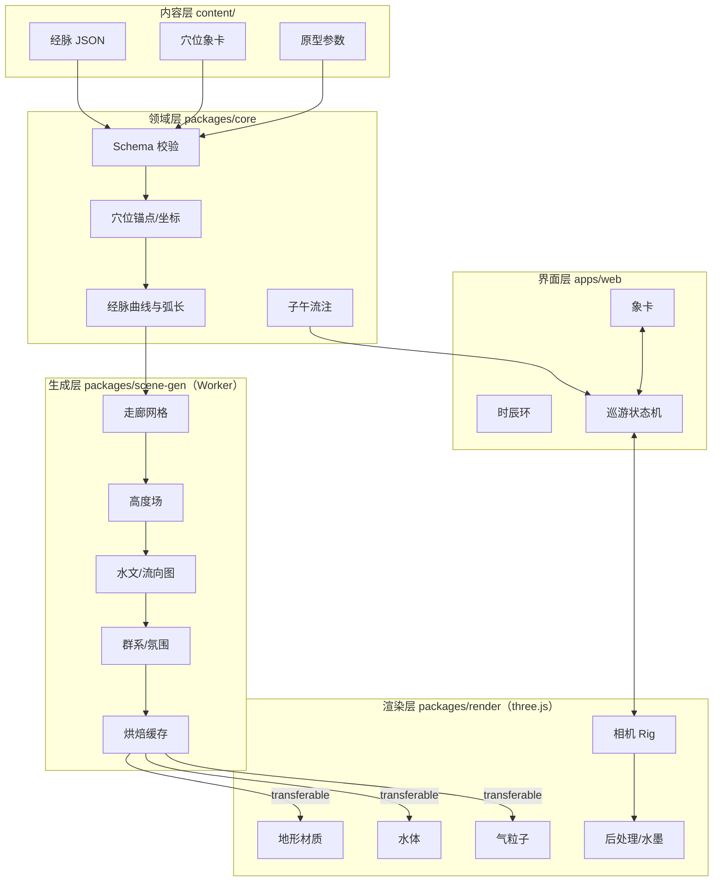

# 游脉山河 · 实现架构

> 本文回答一个问题：如何让一块手背皮肤，在浏览器里变成一片可行走的山水，并且跑得动。

| 项 | 内容 |
| --- | --- |
| 文档版本 | v0.1 |
| 日期 | 2026-11-03 |
| 对应设计 | [01-设计文档](./01-设计文档.md) |
| 范围 | MVP（手阳明大肠经）到 M2（十二经）的技术方案 |

---

## 1. 架构目标与约束

### 1.1 目标

1. **双象可读**：同一张体表网格，近看是皮肤，远看是山水。
2. **毫秒级尺度的沉浸**：相机可贴到皮肤上方 1–5mm 飞行，不穿模、不抖动。
3. **内容驱动**：新增经脉/穴位只改内容，不改引擎。
4. **确定性**：同一 seed、同一时辰，生成的场景完全一致，可复现、可分享。
5. **可降级**：桌面 60fps；移动端至少能看静态长卷。
6. **可审校**：每条场景参数都能追溯到象元与经典依据。

### 1.2 硬约束

| 约束 | 说明 |
| --- | --- |
| 运行环境 | 现代浏览器，WebGL2 为基线；WebGPU 作为后续实验 |
| 包体 | 首屏 JS < 1.5MB gzip；场景资源按需加载 |
| 帧率 | 桌面 60fps（P95 帧时间 ≤ 20ms）；移动 30fps |
| 精度 | 1mm 级地形细节；相机近平面 0.5mm |
| 内容 | 全身 361 经穴，不能为每个穴手工建模 |
| 团队 | 小团队（1–2 前端 + 1 美术/技术美术 + 内容顾问） |

### 1.3 核心判断

**不做「人体模型 + 山水贴图」，而做「体表走廊地形」。**

- 全身毫米级网格化不可行（数十亿体素）。
- 但用户一次只看一条经、一段几十厘米的走廊。
- 因此：**只在高亮经脉周围生成一条高精度地形走廊**，其余身体保持低模剪影。
- 走廊是参数化网格（沿经弧长 `s` × 横向 `t`），天然适配河流、粒子和镜头。

这条判断决定了后面所有设计。

---

## 2. 技术选型

| 层 | 选择 | 理由 | 备选 |
| --- | --- | --- | --- |
| 语言 | TypeScript（strict） | 内容模型复杂，需要类型约束 | — |
| 构建 | Vite | 快、生态好、worker 支持好 | — |
| UI | React 19 | 象卡/时辰环等复杂状态 UI | Svelte |
| 3D | three.js（WebGL2） | 生态成熟、shader 可控、体积可接受 | Babylon.js |
| 场景装配 | @react-three/fiber + drei | 声明式装配，和 React UI 同栈 | 纯命令式 |
| 状态 | zustand（应用态）+ xstate（巡游状态机） | 轻量 + 显式状态迁移 | Redux |
| 校验 | zod | 内容 schema + 运行时校验 | valibot |
| Worker | Comlink | RPC 化，少写 postMessage 样板 | 原生 |
| 后处理 | three 自定义 Pass + postprocessing | 水墨/景深需要自定义 | — |
| 音频 | Web Audio API | 程序化水声/风声，无需大音频包 | Howler |
| 测试 | Vitest + Playwright | 单测 + 视觉回归 | — |
| 包管理 | pnpm workspace | monorepo | npm |

**为什么不是纯 R3F**：地形生成、粒子模拟、相机 rig 是每帧热路径，用命令式 three 更可控；R3F 只负责场景图装配和与 React 生命周期对齐。两者通过 ref 桥接。

**为什么暂不上 WebGPU**：WebGL2 覆盖足够；水墨后处理与浮点纹理在 WebGL2 上可控；WebGPU 留到 M3 做实验分支。

---

## 3. 总体架构



**数据流**：

1. 启动时加载经脉 + 象卡，zod 校验，构建只读领域对象。
2. 选定经脉后，`core` 计算穴位序列、曲线、弧长参数、五输节点。
3. 主线程把「曲线 + 参数 + seed」发给 Worker。
4. Worker 生成走廊高度场、水文图、群系实例、氛围参数，回传 ArrayBuffer。
5. 主线程上传 GPU，装配场景；相机沿曲线飞行。
6. 时间系统每帧更新 `tide`、粒子、水面；不重新生成地形。
7. 用户切经脉/改 seed 时，走「生成 → 交叉淡入」流程。

---

## 4. 工程结构

```
zhongyi/
├─ apps/
│  └─ web/
│     ├─ src/
│     │  ├─ app/                 # 入口、路由、Providers
│     │  ├─ journey/             # 巡游状态机、时间轴、镜头脚本
│     │  ├─ scene/               # R3F 场景装配、资源加载
│     │  ├─ ui/                  # 象卡、时辰环、HUD、无障碍层
│     │  ├─ workers/             # scene-gen.worker.ts
│     │  └─ styles/
│     └─ public/
│        ├─ models/              # body.glb, props
│        └─ textures/            # KTX2
├─ packages/
│  ├─ core/
│  │  ├─ src/schema/             # zod schema + 类型
│  │  ├─ src/meridian/           # 曲线、弧长、五输
│  │  ├─ src/time/               # 子午流注、tide
│  │  ├─ src/anatomy/            # 锚点、骨骼帧、表面投影
│  │  └─ src/rng/                # 确定性随机
│  ├─ scene-gen/
│  │  ├─ src/corridor/           # 走廊参数化网格
│  │  ├─ src/height/             # 高度函数与特征
│  │  ├─ src/hydro/              # 流向、汇流、水面
│  │  ├─ src/biome/              # 植被、雾、色板
│  │  └─ src/protocol.ts         # Worker 消息协议
│  ├─ render/
│  │  ├─ src/materials/          # 地形、水、粒子
│  │  ├─ src/passes/             # 景深、水墨、纸纹
│  │  ├─ src/camera/             # 相机 Rig
│  │  └─ src/shaders/
│  └─ content/
│     └─ src/load.ts             # 加载、索引、检索
├─ content/
│  ├─ meridians/
│  │  └─ hand-yangming-large-intestine.json
│  └─ archetypes/
│     └─ valley.json …
├─ tools/
│  ├─ preview/                   # 单穴场景预览（Vite 子应用）
│  └─ anchor-editor/             # 锚点标注工具（读 GLB，导出 JSON）
└─ docs/
```

**依赖方向**：`core` 不依赖 three；`scene-gen` 不依赖 three；`render` 依赖 three；`web` 依赖全部。这样地形算法可以单独测试，也可以复用到离线烘焙。

---

## 5. 领域模型

### 5.1 类型定义

```ts
// packages/core/src/schema/types.ts
export type MeridianId =
  | 'LU' | 'LI' | 'ST' | 'SP' | 'HT' | 'SI'
  | 'BL' | 'KI' | 'PC' | 'TE' | 'GB' | 'LR';

export type FiveElement = '木' | '火' | '土' | '金' | '水';
export type WushuStage = '井' | '荥' | '输' | '经' | '合';
export type PointRole =
  | '原' | '络' | '郄' | '募' | '俞' | '八会' | '八脉交会';

export interface Anchor {
  /** 骨骼帧名，如 'hand.R'、'forearm.R' */
  frame: string;
  /** 骨骼局部坐标（米） */
  local: [number, number, number];
  /** 体表法线（可选，用于初始朝向） */
  normal?: [number, number, number];
  /** 体表 UV（可选，用于贴图与快速投影） */
  uv?: [number, number];
}

export interface SceneImage {
  /** 穴名拆出的象元，如 ['合','谷'] */
  tokens: string[];
  /** 场景原型，如 'valley' */
  archetype: string;
  /** 原型参数，缺省走原型默认值 */
  params: Record<string, number>;
  /** 修饰词，如 ['sunlit','convergence'] */
  modifiers: string[];
  /** 确定性种子 */
  seed: number;
}

export interface PointText {
  literal: string;          // 字解
  imagery: string;          // 象
  qi: string;               // 气机
  function?: string;        // 传统功用（标注为非医疗建议）
  classics: Array<{ source: string; quote?: string; note?: string }>;
  sceneCue: string;         // 一句话场景提示，给美术/生成器
}

export interface Acupoint {
  code: string;             // 'LI4'
  name: string;             // '合谷'
  pinyin: string;
  meridian: MeridianId;
  order: number;
  location: string;         // 标准定位描述
  anchor: Anchor;
  /** 内容阶段标记：placeholder 表示待 Blender 标定 */
  anchorStatus?: 'placeholder' | 'authored';
  wushu: { stage: WushuStage; element: FiveElement } | null;
  roles: PointRole[];
  image: SceneImage;
  text: PointText;
}

export interface Meridian {
  id: MeridianId;
  name: string;
  shortName?: string;
  element: FiveElement;
  organ: string;
  river: { name: string; source: string };
  schedule: { branch: string; startHour: number; endHour: number };
  palette: { primary: string; accent: string; water: string };
  points: Acupoint[];
}
```

### 5.2 Zod 校验

```ts
// packages/core/src/schema/meridian.ts
import { z } from 'zod';

const AnchorSchema = z.object({
  frame: z.string().min(1),
  local: z.tuple([z.number(), z.number(), z.number()]),
  normal: z.tuple([z.number(), z.number(), z.number()]).optional(),
  uv: z.tuple([z.number(), z.number()]).optional(),
});

const SceneImageSchema = z.object({
  tokens: z.array(z.string().min(1)).min(1).max(4),
  archetype: z.string().min(1),
  params: z.record(z.number()).default({}),
  modifiers: z.array(z.string()).default([]),
  seed: z.number().int().nonnegative(),
});

export const AcupointSchema = z.object({
  code: z.string().regex(/^[A-Z]{2}\d{1,2}$/),
  name: z.string().min(1),
  pinyin: z.string().min(1),
  meridian: z.enum(['LU','LI','ST','SP','HT','SI','BL','KI','PC','TE','GB','LR']),
  order: z.number().int().positive(),
  location: z.string().min(1),
  anchor: AnchorSchema,
  anchorStatus: z.enum(['placeholder', 'authored']).default('placeholder'),
  wushu: z.object({
    stage: z.enum(['井','荥','输','经','合']),
    element: z.enum(['木','火','土','金','水']),
  }).nullable(),
  roles: z.array(z.enum(['原','络','郄','募','俞','八会','八脉交会'])).default([]),
  image: SceneImageSchema,
  text: z.object({
    literal: z.string().min(1),
    imagery: z.string().min(1),
    qi: z.string().min(1),
    function: z.string().optional(),
    classics: z.array(z.object({
      source: z.string().min(1),
      quote: z.string().optional(),
      note: z.string().optional(),
    })).default([]),
    sceneCue: z.string().min(1),
  }),
});

export const MeridianSchema = z.object({
  schemaVersion: z.literal('0.1.0'),
  id: z.enum(['LU','LI','ST','SP','HT','SI','BL','KI','PC','TE','GB','LR']),
  name: z.string(),
  shortName: z.string().optional(),
  element: z.enum(['木','火','土','金','水']),
  organ: z.string(),
  river: z.object({ name: z.string(), source: z.string() }),
  schedule: z.object({
    branch: z.string(),
    startHour: z.number().min(0).max(23),
    endHour: z.number().min(0).max(24),
  }),
  palette: z.object({
    primary: z.string().regex(/^#[0-9a-fA-F]{6}$/),
    accent: z.string().regex(/^#[0-9a-fA-F]{6}$/),
    water: z.string().regex(/^#[0-9a-fA-F]{6}$/),
  }),
  points: z.array(AcupointSchema).min(1),
});
```

校验在 CI 与运行时各做一次：CI 防止内容合入错误；运行时防止旧缓存/外部内容破坏。

---

## 6. 坐标系统与身体基座

### 6.1 单位与精度

- 世界单位：**米**。手长约 0.18m，前臂约 0.25m。
- 相机近平面：0.0005m（0.5mm），远平面 2m。
- `logarithmicDepthBuffer: true`，避免毫米到米跨度的 z-fighting。
- **浮动原点**：每个走廊 chunk 以自身中心为局部原点，顶点坐标存相对值；相机也在同一局部帧渲染。避免 float32 在毫米尺度下的抖动。

### 6.2 身体基座

MVP 用一份带骨骼的 GLB：

- 来源：MakeHuman/MPFB 基础人体，或美术雕刻的低模（约 30k–60k 三角面）。
- 骨架：至少包含 `hand.R`、`forearm.R`、`upperarm.R`、`shoulder.R`、`neck`、`head`。
- 体表：单一蒙皮网格，带 UV。
- 用途：远景剪影、双象切换的「体」层、锚点投影的载体。

**不直接对全身做高模 displacement**。高精度只发生在走廊内。

### 6.3 穴位锚点

锚点 = 骨骼帧 + 局部坐标 + 体表法线。作者在 Blender 插件或 `tools/anchor-editor` 中点击体表取点，导出：

```json
{
  "frame": "hand.R",
  "local": [0.021, -0.004, 0.013],
  "normal": [0.12, 0.93, 0.34],
  "uv": [0.412, 0.677]
}
```

运行时投影流程：

1. 骨骼帧变换 → 世界坐标初值。
2. 在该点附近用 BVH 求体表最近点，得到精确表面位置与法线。
3. 若 UV 存在，用 UV 做一次一致性校验（防止左右手/姿态错位）。
4. 结果缓存；换姿势时只需重算矩阵，不需重新做 BVH（局部坐标不变）。

内容创作阶段允许 `anchorStatus: "placeholder"`（样例数据中的坐标即为占位值）。`content:build` 在发布模式下若发现任何 placeholder，直接失败并列出待标定穴位——**不允许占位坐标进入生产**。

### 6.4 双象的实现

| 层 | 内容 | 精度 | 作用 |
| --- | --- | --- | --- |
| 体表基座 | 全身蒙皮网格 | 低模 + 法线贴图 | 远处看是身体 |
| 走廊地形 | 沿经高精度 displacement | 1mm | 近处看是山水 |
| 双象遮罩 | 按相机距离/角度混合 | — | 远山渐显、皮肤渐隐 |

混合不是简单的透明度：远景时走廊地形降到与基座同形，靠**法线细节 + 雾 + 色板**读作山水；近景时基座让位，走廊接管。切换用「体/境」滑杆控制一个 0–1 的 uniform，避免突兀。

---

## 7. 经脉曲线

### 7.1 从穴位到曲线

```
p0..pn (表面点)
  → Catmull-Rom（3D）
  → 每 1mm 采样
  → 投影回体表（BVH）
  → 拉普拉斯平滑 2–3 次（保形）
  → 弧长参数化 s ∈ [0, L]
```

### 7.2 曲线坐标系

对每个弧长 `s` 计算：

- 切向 `T(s)`：曲线导数归一化。
- 表面法线 `N(s)`：体表法线。
- 副法线 `B(s) = T × N`：横向。
- 走廊坐标：`P(s, t) = Surface(s) + N(s) · H(s,t) + B(s) · t`。

`s` 沿经，`t` 横向（约 ±3cm）。所有地形、河流、粒子都在这个 `(s,t)` 参数域里工作。

### 7.3 五输节点

五输穴在曲线上的位置天然给出「水形态」分段：

```ts
interface FlowStage {
  stage: WushuStage;
  s0: number;       // 起始弧长
  s1: number;
  width: number;    // 河宽系数
  speed: number;    // 流速系数
  depth: number;    // 下切深度
}
```

非五输穴按到最近五输节点的距离插值，保证水面连续。

### 7.4 根结流注（可选层）

《灵枢·根结》另有一套「根—溜—注—入」的走向（如手阳明：商阳 → 合谷 → 阳溪 → 扶突）。MVP 不实现，但数据模型预留 `flowVariant` 字段，M2 可作为「另一种走法」的叠加层。

---

## 8. 地形生成

### 8.1 走廊网格

在 `(s,t)` 域生成自适应网格：

- 纵向步长：近景 1mm，中景 4mm，远景 1cm。
- 横向：中心密、边缘疏；总宽 6–10cm，谷地/池局部加宽。
- 每个 chunk 约 64×64 顶点，沿经切成若干段。
- 边缘顶点高度向基座网格回归，保证接缝不裂。

```ts
interface CorridorChunk {
  s0: number; s1: number;
  origin: [number, number, number];  // 浮动原点
  positions: Float32Array;           // xyz
  normals: Float32Array;
  uvs: Float32Array;                 // (s,t) 归一化
  indices: Uint32Array;
  heightRange: [number, number];
}
```

### 8.2 高度函数

```ts
function heightAt(p: SurfacePoint, ctx: SceneContext): number {
  let h = 0;

  // 1. 解剖：骨脊与肌肉隆起
  h += ctx.anatomy.boneRidges(p) * ctx.weights.bone;      // 0.4–0.8
  h += ctx.anatomy.muscleHills(p) * ctx.weights.muscle;   // 0.2–0.5

  // 2. 象元特征：谷、脊、潭、台……
  for (const f of ctx.features) h += f.evaluate(p);

  // 3. 经脉下切：河道
  h -= ctx.river.carve(p);

  // 4. 细节：fbm + 皴法
  h += fbm(p.s * 40, p.t * 40) * ctx.detailAmp;           // 0.2–1mm

  return h;
}
```

**骨脊**：对每根骨骼线段求距离 `d`，`A_b * exp(-(d/σ_b)²)`。掌骨就是两条高脊。

**肌肉**：metaball 叠加，`Σ A_i * exp(-(d_i/σ_i)²)`。

**河道下切**：

```
carve(p) = D(s) * exp(-(t / w(s))²)
```

`D(s)` 由五输阶段决定：井 0.5mm，荥 1mm，输 1.5mm，经 2.5mm，合 4mm。`w(s)` 是河宽。

> **安全约束**：`H` 是艺术位移，不是真实皮肤厚度。位移振幅设上限（默认 6mm），并在生成时检查「不穿骨、不穿透对侧皮肤」；超出时压缩振幅，优先保解剖。所有夸张在「体/境」滑杆回到 0 时完全消失。

**谷地特征**（valley archetype）：

```
F_valley(p) = -A * exp(-(t/σ)²)                      // 谷底
            + A * 0.7 * exp(-((t-w)/σr)²)            // 左脊
            + A * 0.7 * exp(-((t+w)/σr)²)            // 右脊
            + A * 0.4 * exp(-((s-s0)/σs)²)           // 谷口收束
```

`合` 修饰词提高 `A` 与 `w`，让两脊更近、谷口更窄；`原` 身份在谷底加一个泉眼（局部上涌）。

### 8.3 水文

不跑完整流体模拟，分两步：

1. **汇流**：在走廊网格上做 D∞ 流向 + 汇流累积。以经脉曲线为「先验河道」，沿 `s` 方向给一个高初始汇流值，保证主河稳定；两侧地形产生支流。
2. **水面**：由汇流量 `A` 与坡度 `S` 计算

```
width  = k_w * sqrt(A)
speed  = k_v * sqrt(S)
depth  = k_d * A^0.4
pool   = smoothstep(S_low, 0, S)   // 坡度越低越容易成潭
```

输出一张 `flowMap`（RG = 速度方向，B = 汇流，A = 水深）供 GPU 采样。

### 8.4 群系与氛围

原型不直接生成「树」，而是生成参数：

```ts
interface BiomeSpec {
  palette: { ground: string; rock: string; water: string; fog: string };
  vegetation: { density: number; height: number; kind: 'grass'|'shrub'|'bamboo'|'reed' };
  fog: { density: number; height: number; color: string };
  props: Array<{ kind: string; s: number; t: number; scale: number }>;
  ambient: { wind: number; humidity: number; lightAngle: number; lightTemp: number };
}
```

渲染层把参数变成实例化植被、雾片、光柱。**生成层不碰 three 对象**，保证可测试、可离线烘焙。

### 8.5 确定性与缓存

- 所有随机走 `mulberry32(hash(meridianId, pointCode, seed, stage))`。
- 生成结果按 `hash(request)` 缓存在 IndexedDB；同一 seed 二次进入秒开。
- 内容更新时 `schemaVersion` + `contentHash` 变化，缓存失效。

---

## 9. 气与粒子

### 9.1 无状态粒子

不做逐帧积分（难回放、易漂移），用**相位 + 曲线**：

```glsl
float u = fract(aPhase + uSpeed * uTime / uLength);
vec3 p = curveAt(u);                       // 预烘焙曲线纹理
p += normalAt(u) * (0.002 + 0.001 * noise);
p += biTangentAt(u) * swirl(u, aSeed);     // 谷地旋涡 / 池面环流
```

- 5 万–6 万个点，`InstancedBufferGeometry`，加法混合。
- 曲线位置/法线/副法线预烘焙到 `DataTexture`（如 2048×1），GPU 采样，零顶点动画。
- 每个粒子的透明度按 `u` 淡入淡出，避免源头/终点突兀。

### 9.2 按原型改变行为

| 原型 | 粒子行为 |
| --- | --- |
| 井 | 从一点向上涌，速度慢，扩散小 |
| 溪 | 沿河道直行，轻微抖动 |
| 谷 | 在谷底形成回旋，部分粒子沿两脊上升 |
| 池 | 环流 + 缓慢下沉，偶有上浮 |
| 海 | 大范围漂移，速度低，密度高 |
| 关 | 加速穿过隘口，形成「风线」 |

用 `archetypeId` 选一个行为分支，参数来自 `image.params`。

### 9.3 潮汐

```ts
// 0.15（安静）→ 1.0（当令）
function tide(meridian: MeridianId, hour: number): number {
  const [start, end] = SCHEDULE[meridian];
  const inWindow = isInWindow(hour, start, end);
  if (!inWindow) return 0.15;
  const phase = windowPhase(hour, start, end); // 0..1
  return 0.15 + 0.85 * (0.5 - 0.5 * Math.cos(phase * Math.PI * 2));
}
```

`tide` 驱动：水位、粒子速度、雾密度、水面亮度、音效音量。**不触发地形重建。**

### 9.4 候气交互

按住时：

1. 局部水面法线扰动（uniform `uPress`）。
2. 粒子向按压点汇聚（在 shader 里加一个吸引项）。
3. 一圈涟漪（屏幕空间或 decal）。
4. 低频声渐强。

纯视觉反馈，不映射任何生理读数，避免「检测经络」的伪科学暗示。

---

## 10. 渲染管线

### 10.1 场景图

```
Scene
├─ BodyBase            // 低模身体，双象的「体」
├─ TerrainCorridor     // 走廊 chunk × N
├─ RiverSystem         // 水面 ribbon + 池面
├─ QiParticles         // 点精灵
├─ Vegetation          // InstancedMesh
├─ Props               // 亭、碑、鼎、门…
├─ Atmosphere          // 雾、云、光柱
├─ CameraRig
└─ PostStack           // DOF → Ink → Paper → Grade
```

### 10.2 材质

**地形**：

- 按高度/坡度做三路混合：土、石、苔。
- 法线细节用两层不同尺度的噪声（0.5mm / 3mm）。
- 加一层「皴法」：用方向性噪声调制明暗，模拟披麻皴/斧劈皴。
- 远景降低细节，靠雾与色块。

**水面**：

- 顶点沿法线抬高 0.2mm，做微波。
- 法线贴图两层滚动（流速来自 `flowMap`）。
- Fresnel + 假反射（采样天空色/环境探针）。
- 浅水处加泡沫（按水深与坡度）。
- 池面降低流速、提高反射、拉长高光。

**粒子**：

- 加法混合，颜色来自经脉色板，亮度受 `tide` 调制。
- 近处粒子稍大、远处衰减；避免「一锅萤火虫」。

### 10.3 后处理

| Pass | 作用 | 成本 |
| --- | --- | --- |
| DepthOfField | 微距感；焦点跟随相机前方 | 中 |
| Ink | 基于深度/法线的边缘线 + 墨扩散 | 中 |
| Paper | 纸纹、纤维、轻微色偏 | 低 |
| Grade | 青绿/水墨/星图三套 LUT | 低 |
| Vignette | 收边 | 低 |

**降级顺序**：DOF → Ink → 植被密度 → 粒子数 → 地形 LOD → 静态长卷。

### 10.4 相机 Rig

```ts
interface CameraKey {
  u: number;              // 曲线参数
  height: number;         // 离地高度
  lookAhead: number;      // 前瞻距离
  fov: number;
  dwell?: boolean;
}

class CameraRig {
  update(dt: number) {
    const u = this.flow.advance(dt);
    const p = this.curve.sample(u);
    const n = this.curve.normal(u);
    const target = p.clone().addScaledVector(n, this.heightAt(u));
    // 弹簧平滑，避免抖动
    this.position.lerp(target, 1 - Math.exp(-dt * 6));
    this.lookAt(this.curve.sample(u + this.lookAhead));
    // 防止穿地
    this.position.y = Math.max(this.position.y, this.terrainHeight(this.position) + 0.002);
  }
}
```

- 转弯侧倾 ≤ 3°，可在设置中关闭。
- 镜头速度按五输阶段：井 0.15 m/s，经 0.6 m/s，合 0.2 m/s。
- `prefers-reduced-motion` 时，`flow.advance` 改为用户手动。

---

## 11. 时间与状态

### 11.1 三个时钟

```ts
class WorldClock {          // 真实/虚拟时间，驱动子午流注
  private virtualMinutes = 0;
  constructor(private speed = 1) {}
  tick(dt: number) { this.virtualMinutes += dt * this.speed / 60; }
  get hour() { return (this.virtualMinutes / 60) % 24; }
}

class FlowClock {           // 单经行进，0..1
  progress = 0;
  rate = 0.02;              // 每秒 2%
  tick(dt: number) { this.progress = clamp01(this.progress + this.rate * dt); }
}

class DwellClock {          // 穴位停留
  remaining = 0;
  tick(dt: number) { this.remaining = Math.max(0, this.remaining - dt); }
}
```

### 11.2 巡游状态机（xstate）

```ts
const journeyMachine = createMachine({
  id: 'journey',
  initial: 'overview',
  states: {
    overview:   { on: { SELECT_MERIDIAN: 'transit' } },
    transit:    { on: { READY: 'tour', CANCEL: 'overview' } },
    tour:       { on: { ARRIVE: 'dwell', PAUSE: 'paused', EXIT: 'overview' } },
    dwell:      { on: { CONTINUE: 'tour', EXIT: 'overview' }, after: { 40000: 'tour' } },
    paused:     { on: { RESUME: 'tour', EXIT: 'overview' } },
  },
});
```

状态只描述「在哪」，具体镜头/音频/UI 由各状态进入时的 actions 编排。

### 11.3 子午流注

```ts
const SCHEDULE: Record<MeridianId, [number, number]> = {
  LU: [3, 5],  LI: [5, 7],  ST: [7, 9],  SP: [9, 11],
  HT: [11, 13], SI: [13, 15], BL: [15, 17], KI: [17, 19],
  PC: [19, 21], TE: [21, 23], GB: [23, 1], LR: [1, 3],
};
```

边界处理：`GB` 与 `LR` 跨午夜，用 `isInWindow` 统一处理环绕。

---

## 12. 内容流水线

### 12.1 作者工作流

```
写 JSON（或 YAML 后转 JSON）
  → pnpm content:validate     # zod + 引用 + 字段完整性
  → pnpm content:lint         # 禁用词、疗效表述、字数
  → pnpm dev                  # /preview?point=LI4 实时预览
  → 调 seed / 参数            # 预览页可直接拖参数，导出回 JSON
  → pnpm content:build        # 生成 bundle + contentHash + 索引
```

### 12.2 预览工具

`tools/preview` 是一个独立 Vite 页面：

- 左：3D 场景（同一套 render 包）。
- 右：JSON 参数面板（archetype、params、seed、时辰、tide）。
- 底：象卡实时预览。
- 按钮：「复制参数」「对比 seed」「导出截图」。

这让美术/内容顾问不需要改代码就能调场景。

### 12.3 内容分级

| 级别 | 场景深度 | 数量目标 |
| --- | --- | --- |
| 深度穴 | 完整分镜、专属道具、候气 | 12–20 个（合谷、曲池、迎香…） |
| 标准穴 | 原型 + 参数 + 象卡 | 100–150 个 |
| 简略穴 | 河流 + 标记 + 一句话 | 其余 |

生成器保证三级都能出景，只是细节层次不同。

### 12.4 引用与审校

- `classics` 字段必须是结构化对象，禁止自由文本混排。
- CI 检查：每条 `quote` 必须能在 `content/citations/` 的原文库中找到（模糊匹配阈值）。
- 禁用词表：治疗、治愈、疗效、根治、神效、量子、能量场、磁场…
- 「设计演绎」文本单独字段，渲染时加标记。

---

## 13. 性能

### 13.1 预算（桌面）

| 项 | 预算 |
| --- | --- |
| 帧时间 | 16.6ms（P95 ≤ 20ms） |
| CPU | ≤ 5ms |
| GPU | ≤ 10ms |
| Draw calls | ≤ 250 |
| 三角面 | ≤ 600k |
| 粒子 | ≤ 60k |
| 纹理显存 | ≤ 256MB |
| 地形生成 | ≤ 1.5s / 段（Worker） |

### 13.2 手段

- **走廊 LOD**：近 1mm、中 4mm、远 1cm；只保留相机前后各 2 段高精度。
- **Instancing**：植被、石、粒子全部实例化。
- **纹理压缩**：KTX2 + Basis；法线用 BC5/ASTC。
- **曲线烘焙**：曲线采样存 `DataTexture`，粒子/水面共用。
- **Worker 池**：2–4 个 worker，按段并行；主线程只做上传。
- **缓存**：IndexedDB 存生成结果，二次进入 < 200ms。
- **按需加载**：只加载当前经脉的模型/纹理；其余预取元数据。

### 13.3 降级矩阵

| 设备 | 地形 | 粒子 | 后处理 | 植被 |
| --- | --- | --- | --- | --- |
| 桌面高端 | 1mm | 60k | DOF + Ink + Paper | 全量 |
| 桌面集显 | 2mm | 30k | Ink + Paper | 半量 |
| 移动 | 4mm | 12k | Grade | 少量 |
| 低端/省电 | 静态长卷 | 0 | 无 | 0 |

检测方式：`renderer.capabilities` + 首帧耗时 + `navigator.hardwareConcurrency`，三帧内决定档位，之后不再频繁切换。

---

## 14. 测试与质量

### 14.1 单元测试

- schema 校验：所有内容通过；错误内容报错可读。
- 经脉曲线：弧长单调、五输节点顺序正确。
- 子午流注：24 小时边界、跨午夜。
- 高度函数：谷地中心低于两脊、河道低于岸。
- RNG：同 seed 同输出。

### 14.2 黄金测试

对每个原型固定 seed，输出高度场统计（min/max/mean/分位数）与关键点高度，存快照。算法改动导致地形漂移时，测试会失败，强制 review。

### 14.3 视觉回归

Playwright 固定：

- 相机位姿（`s`、`height`、`lookAt`）
- 虚拟时间（`hour`）
- seed
- 分辨率与 DPR

截图对比阈值 0.5%。重点覆盖：合谷、曲池、迎香、谷/池/关三个原型。

### 14.4 性能测试

- 每帧记录 CPU/GPU 时间，CI 跑 300 帧取 P95。
- 回归阈值：P95 超过基线 15% 失败。
- 首屏：LCP < 2.5s，场景可交互 < 5s（本地）。

### 14.5 内容测试

- 每条经的穴位数量、顺序、五输完整性。
- 引用可解析。
- 禁用词零命中。
- 象元必须在词典中登记。

### 14.6 无障碍测试

- axe-core 零严重问题。
- 键盘走完「观 → 游 → 驻 → 象卡 → 退出」。
- `prefers-reduced-motion` 下无自动镜头运动。

---

## 15. 部署

- **静态托管**：Cloudflare Pages / Vercel；无服务端状态。
- **资源**：模型/纹理走 CDN，immutable 缓存；`contentHash` 做版本。
- **PWA**：Service Worker 缓存当前经脉资源，支持离线重游。
- **URL 状态**：

```
/?m=LI&p=LI4&t=05:30&mode=ink&seed=10404
```

可分享到具体穴位、时辰、视觉模式。

- **分享卡**：Canvas 截图 + 穴名 + 字解 + 二维码；不包含任何个人数据。
- **分析**：Plausible/Umami 之类无 cookie 方案；只记事件（开始巡游、到达穴位、翻象卡），不记健康信息。

---

## 16. 里程碑（工程视角）

| 阶段 | 工程任务 | 验收 |
| --- | --- | --- |
| **M0** | 身体 GLB + 锚点工具；6 个穴位；走廊网格；高度函数；雾/水/相机 | 合谷场景可环绕 60fps；谷地形态成立 |
| **M1** | 20 穴；6 原型；粒子；象卡；xstate；预览工具 | 走完整条经；象卡可翻；参数可调 |
| **M2** | 十二经；全身基座；子午流注；性能优化；缓存 | 十二经可切换；当令经涨潮；移动端可看 |
| **M3** | 分享；PWA；音频；移动交互；无障碍 | URL 分享；离线重游；键盘全流程 |
| **M4** | 四时；更多原型；VR 实验；多语言 | 按内容规划 |

---

## 17. 风险与备选

| 风险 | 影响 | 应对 |
| --- | --- | --- |
| 毫米级地形性能不足 | 帧率崩 | 走廊 + LOD；降级到 2.5D 长卷 |
| 双象读不出来 | 核心创意失败 | M0 做知觉测试；加强剪影/雾/色板；备选「画卷模式」 |
| 身体模型质量差 | 不像身体 | 用 MakeHuman/MPFB 基础网格 + 美术修形；或只做手+臂 |
| 浮点精度抖动 | 镜头晃 | 浮动原点 + 对数深度 |
| 内容产能不足 | 361 穴做不完 | 三级内容；生成器起草 + 人工审校 |
| 晕动症 | 用户流失 | 舒适模式；无侧倾；手动推进；静态长卷 |
| 医学表述风险 | 合规/信任 | 禁用词 + 三层文本 + 免责声明 + 顾问审 |
| WebGL 兼容 | 部分设备打不开 | 特性检测；2D 降级页；提示浏览器要求 |

### 备选方案：2.5D 画卷模式

如果 3D 微距成本过高，退化为「体表展开图 + 高度雾」：

- 把走廊 `(s,t)` 直接映射到屏幕，做成横轴长卷。
- 用视差层（前景粒子、中景地形、远景雾）制造纵深。
- 仍保留水流、粒子、象卡、时辰。
- 优点：性能好、移动端友好、更像古画；缺点：沉浸感弱。

这个模式建议**始终保留**，作为低端设备与无障碍的兜底。

---

## 18. 附录

### 18.1 Worker 协议

```ts
// packages/scene-gen/src/protocol.ts
export type BuildStage = 'route' | 'height' | 'hydro' | 'biome' | 'bake';

export interface BuildRequest {
  requestId: string;
  meridianId: string;
  seed: number;
  quality: 'low' | 'mid' | 'high';
  hour: number;
}

export type BuildMessage =
  | { type: 'progress'; requestId: string; stage: BuildStage; progress: number }
  | { type: 'done'; requestId: string; payload: BuildPayload }
  | { type: 'error'; requestId: string; message: string };

export interface BuildPayload {
  chunks: Array<{
    s0: number; s1: number;
    origin: [number, number, number];
    positions: ArrayBuffer;
    normals: ArrayBuffer;
    indices: ArrayBuffer;
  }>;
  flowMap: { width: number; height: number; data: ArrayBuffer };
  biome: unknown;   // 由 core 的类型约束
  contentHash: string;
}
```

传输用 transferable，避免拷贝大数组。

### 18.2 关键 shader 片段

**水面法线**：

```glsl
vec2 flow = texture(uFlowMap, vUv).rg;
vec2 uv1 = vUv * 3.0 + flow * uTime * 0.02;
vec2 uv2 = vUv * 7.0 - flow * uTime * 0.013;
vec3 n1 = texture(uNormalMap, uv1).xyz * 2.0 - 1.0;
vec3 n2 = texture(uNormalMap, uv2).xyz * 2.0 - 1.0;
vec3 n = normalize(vec3(n1.xy + n2.xy, 1.0));
```

**粒子沿曲线**：

```glsl
float u = fract(aPhase + uTime * uSpeed);
vec3 pos = texture(uCurveTex, vec2(u, 0.5)).xyz;
vec3 nrm = texture(uNormalTex, vec2(u, 0.5)).xyz;
vec3 bin = texture(uBinormalTex, vec2(u, 0.5)).xyz;
float swirl = sin(u * 40.0 + aSeed * 6.28) * uSwirl;
pos += nrm * (0.001 + 0.0008 * sin(uTime + aSeed * 10.0));
pos += bin * swirl;
```

**墨线**：

```glsl
float depthEdge = sobel(uDepth);
float normalEdge = sobel(uNormal);
float ink = smoothstep(0.1, 0.4, max(depthEdge, normalEdge));
vec3 color = mix(baseColor, uInkColor, ink * uInkStrength);
```

### 18.3 目录约定

| 路径 | 约定 |
| --- | --- |
| `content/meridians/*.json` | 一条经一个文件，文件名用英文 |
| `content/archetypes/*.json` | 一个原型一个文件，参数默认值 |
| `packages/core` | 不 import three |
| `packages/scene-gen` | 不 import three；纯数据 |
| `packages/render` | 只做渲染，不含业务状态 |
| `apps/web` | 编排，不写地形算法 |

### 18.4 参考实现顺序（第一周）

1. 加载身体 GLB，OrbitControls 看模型。
2. 在手上标 6 个点（商阳、三间、合谷、阳溪、曲池、迎香）。
3. Catmull-Rom 连成曲线，管状体可视化。
4. 沿曲线生成 `(s,t)` 走廊网格，先做平面。
5. 加高度函数：骨脊 + 河道下切。
6. 相机贴地飞行，加雾。
7. 合谷处加双脊 + 汇水潭。
8. 录屏，判断「像不像谷」。

如果第 8 步不成立，先调地形参数与镜头，不要急着做粒子与 UI。

---

> 架构的成败不在技术栈，而在第 8 步：**当镜头贴着手背飞过时，用户是否真的看见了一个谷。** 其余都是为这一刻服务。


---

## 19. M0 落地状态（2026-11-03）

M0 已实现为可运行原型：程序化手/前臂基座、LI1–LI11 的五个标定锚点、合谷段走廊地形、湿边扫描水面、双象遮罩、三境相机与参数面板。实际取舍、性能数据与 M1 计划见 [M0 实现说明](04-M0实现说明.md)。

与本文档的主要差异：

- 身体基座用程序化网格，暂未接 GLB；锚点投影改为解析手背高度场。
- 走廊先做三间→阳溪（合谷段），网域 199×123，主线程生成约 90ms。
- 地形/水面用自定义 ShaderMaterial；DOF/Ink/Paper 后处理与气粒子留到 M1。
