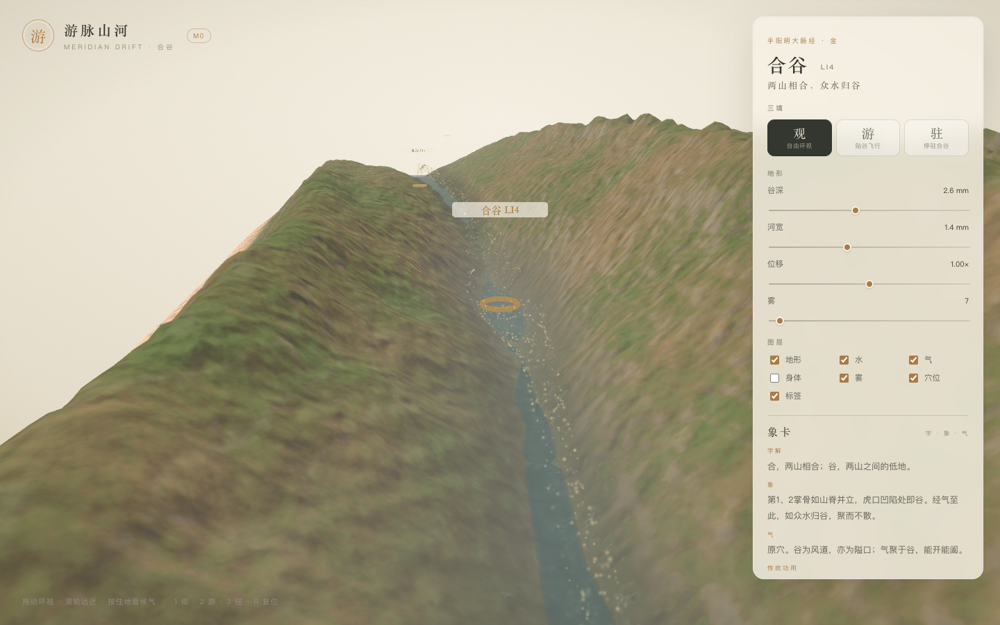
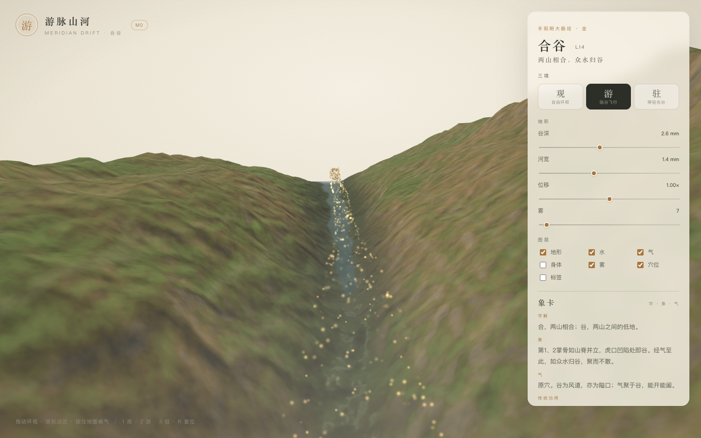
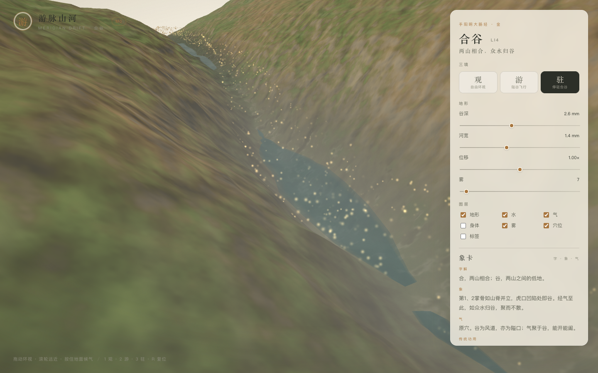
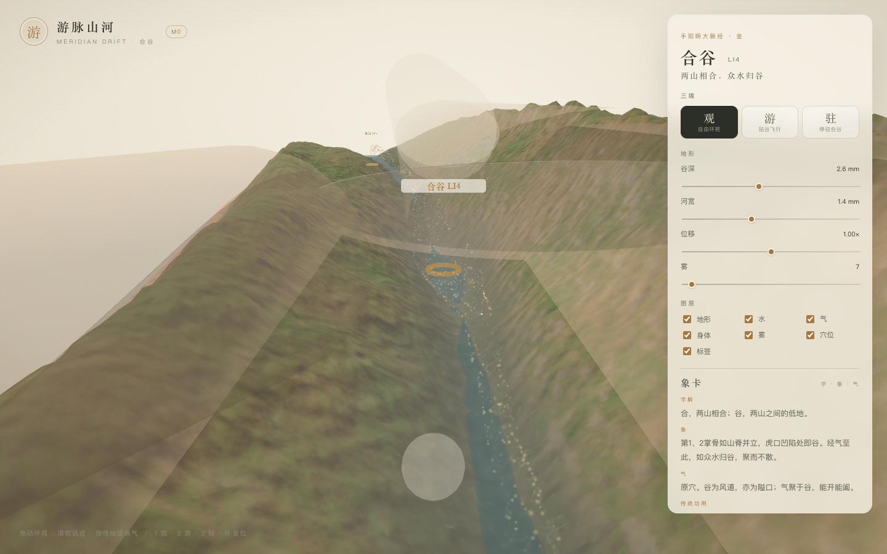

# 游脉山河 · M0 实现说明

> M0 只有一件事：**当镜头贴着手背飞过时，用户是否真的看见了一个谷。**
> 其余都是为这一刻服务。

- 状态：可运行原型（2026-11-03）
- 范围：手阳明大肠经 · 合谷段 · 桌面 Web
- 入口：`pnpm dev` → <http://127.0.0.1:5173>



---

## 1. 结论

1. 合谷段已经能稳定读出「双脊夹谷、溪流归潭」：观/游/驻三种机位下，谷地、山脊、水面与合谷潭都成立。
2. 三境相机与参数面板可用：谷深、河宽、位移、雾实时调整，地形约 90ms 重建一次。
3. 身体层是**程序化占位**（手掌 + 五指 + 前臂），默认关闭；打开后是半透明的「体」层。它不是 M0 的验收重点，M1 会用带骨骼的 GLB 替换。
4. 60fps 尚未在真实 GPU 上验证：无头 SwiftShader 下为 8–18fps，约 5 万三角面，需在目标设备复测。

---

## 2. 运行与复现

```bash
pnpm install
pnpm dev                # http://127.0.0.1:5173
pnpm typecheck
pnpm test
pnpm build
pnpm content:validate   # 0 错误、若干占位警告
pnpm content:build      # 发布门禁：15 个占位锚点 → 按设计失败
pnpm screenshot         # 生成 docs/screenshots/*.png（需先 pnpm dev）
```

镜头可通过 URL 参数复现：`?mode=observe|fly|dwell`、`valley=`、`river=`、`relief=`、`fog=`、`body=1`、`labels=1`、`ui=0`。

| 观 | 游 | 驻 |
| --- | --- | --- |
|  |  |  |

---

## 3. 交付结构

| 路径 | 内容 | 依赖约束 |
| --- | --- | --- |
| `packages/core` | zod schema、锚点与手部解剖面、Catmull-Rom 曲线、弧长、五输、子午流注 | 不 import three |
| `packages/scene-gen` | 走廊网格、高度函数、水文、确定性随机、Worker 协议类型 | 不 import three |
| `packages/render` | 地形/水面材质、程序化身体、穴位标记、雾、相机 Rig | 依赖 three |
| `apps/web` | Vite + React 场景编排、三境切换、参数面板、合谷象卡 | 依赖全部 |
| `tools/content` | 内容校验与发布门禁 | 依赖 core |
| `scripts` | 无头截图、基准 | Node |

`core` 与 `scene-gen` 都可以在 Node 里单测，这正是把地形算法和 three 分开的原因。

---

## 4. 合谷是怎么生成的

### 4.1 坐标与骨骼帧

世界单位是米。右手掌心向下，`hand.R` 帧：

- `+x` 指尖，`+y` 手背，`+z` 拇指侧（桡侧）。
- `forearm.R` 原点在肘部，坐标轴同向（M0 直臂）。
- 手掌 x∈[0, 0.095]，半宽 0.044m；前臂到肘部 x=-0.255m。

手背基面 `palmDorsalY(x,z)` 由掌骨圆顶、掌指关节隆起、鱼际与小鱼际叠加；身体基座与走廊共用这一个基面，所以接缝不会裂。

### 4.2 锚点 → 曲线

M0 只标定五个穴位：**商阳 LI1、三间 LI3、合谷 LI4、阳溪 LI5、曲池 LI11**。

- 锚点 = 骨骼帧 + 局部坐标；手背上的点会贴合到 `palmDorsalY`。
- 向心 Catmull-Rom（α=0.5）连成曲线，按 0.5mm 重采样并弧长参数化。
- 曲线总长约 0.412m；合谷在 s≈0.108m。
- 内容侧仍保留 20 穴与五输信息；M1 再把 LI2、LI6–LI20 标定进来。

### 4.3 走廊 `(s,t)`

沿三间→阳溪生成 `(s,t)` 参数域，t 横向：

- 纵向步长 0.5mm；横向谷底 0.3mm、外缘 1.2mm；网格 199×123。
- 每个顶点先投影回手背基面，再叠加位移：
  - 谷底与两脊（±7.8mm），合谷处两脊略近；
  - 掌骨、鱼际的次级山肩；
  - 五输阶段决定的河道下切（按井→合插值，实际 0.35–1.05mm）；
  - 合谷汇水潭（-1.8mm，椭圆高斯）；
  - fbm + 脊状噪声 + 皴法细纹，振幅合计不超过 6mm；
  - 横向/纵向边缘把位移压回 0，接回皮肤。

实测位移峰值约 5.7mm，在架构文档的 6mm 上限内。

### 4.4 水面

不跑流体模拟，只做两件事：

1. **湿边扫描**：对每个 s，从 t=0 向两侧以 0.2mm 步长找「地形高度 ≤ 水位」的区间，得到左右水线；水面网格直接贴着这条水线生成，避免平面与河床穿插产生的锯齿。
2. **水位**：河道水位 = 谷底 + 0.18mm；合谷处平滑过渡到潭面 + 0.55mm。潭面低于岸线，靠地形遮挡自然形成水线。

水面 shader 做两层滚动法线、fresnel、太阳高光和雾；浅水/深水由 fresnel 与流速线混合。

### 4.5 双象

- 地形横向/纵向边缘（`aEdge`）把颜色混回皮肤色，让山水「化」进手背。
- 身体基座的手掌在走廊范围内挖空（矩形遮罩，比地形略小），地形覆盖在缺口上；地形整体抬高 0.12mm 避免 z-fighting。
- 身体层默认关闭。打开后是 34% 不透明的「体」层，用来看「远看是身体、近看是山水」的关系；它不是最终形态。



### 4.6 三境相机

| 模式 | 机位 | 行为 |
| --- | --- | --- |
| 观（observe） | 合谷上方约 2.5cm，沿谷 3/4 视角 | OrbitControls 自由环绕；显示穴位与标签 |
| 游（fly） | 谷底上方 5.8mm，沿 s 乒乓 | 前瞻 14mm，弹簧平滑，速度 1.1cm/s；隐藏身体与标记 |
| 驻（dwell） | 潭边约 1cm，低机位 | 静看潭面与雾；隐藏身体与标记 |

`prefers-reduced-motion` 时，游速降到 0.2cm/s。

### 4.7 参数面板

- 谷深 0.4–1.8（显示为 1.0–4.7mm 谷深）
- 河宽 0.5–1.8
- 位移 0.6–1.4
- 雾 6–34
- 图层：地形 / 水 / 身体 / 雾 / 穴位 / 标签
- 实时 FPS 与三角面数；「复位视角」；数字键 1/2/3 切三境，R 复位。

参数变化后 120ms 防抖重建地形；重建期间保持旧帧，避免拖动滑块时卡死。

---

## 5. 与架构文档的偏差

| 架构文档 | M0 实际 | 原因 / 计划 |
| --- | --- | --- |
| 带骨骼 GLB 身体 | 程序化手掌 + 前臂，半透明占位 | M0 不引入外部资产；M1 换 GLB + 锚点编辑器 |
| 6 个穴位（含迎香） | 5 个，去掉迎香 | 只做手+臂，脸的基座留到 M1 |
| 走廊覆盖整条经 | 只覆盖三间→阳溪（合谷段） | 先验证「谷」；M1 扩到 LI1–LI11 |
| Worker 生成 + transferable | 主线程同步生成 | 90ms 可接受；M1 迁 Worker + IndexedDB 缓存 |
| R3F 装配场景 | 命令式 three + React 覆盖层 | 热路径更好控；R3F 留到 UI 复杂后引入 |
| DOF / Ink / Paper 后处理 | 只有纸纹 CSS、雾与墨色地形 | M1 接 EffectComposer；先保证 60fps |
| 气粒子 / 候气交互 | 未实现 | M1 |
| 子午流注驱动 | `tide()` 已有单测，潮位固定 0.55 | M1 接真实时间与 UI |

这些偏差都记录在 README 的「M0 已落地」与本文第 7 节。

---

## 6. 验证

| 项 | 结果 |
| --- | --- |
| `pnpm typecheck` | 通过（strict，全仓） |
| `pnpm test` | 15 项通过（schema / 锚点 / 曲线 / 流注 / 网格 / 谷形 / 水面 / 确定性） |
| `pnpm build` | 通过；JS 899kB（gzip 243kB） |
| `pnpm content:validate` | 0 错误，15 个占位锚点警告 |
| `pnpm content:build` | 按设计失败（占位锚点不允许发布） |
| 截图 | `docs/screenshots/` 由 `pnpm screenshot` 生成 |
| 地形重建 | 约 90ms（Apple M 系列，Node 22） |
| 三角面 | 约 5 万（地形 + 水面） |
| 帧率 | 无头 SwiftShader 8–18fps；真实 GPU 待测 |

关键单测：

- 已标定锚点离程序化体表 < 0.5mm；
- 合谷谷底比两侧山脊低 > 2mm；
- 位移峰值 < 6.5mm；
- 潭面低于岸线（水面不漫出）；
- 同参数两次生成逐字节一致。

---

## 7. 已知问题

1. **手的剪影粗糙**：程序化手掌是平板 + 胶囊手指，打开身体层会看到手指像香肠、遮罩边缘有直边。M1 换 GLB。
2. **近景地形偏软**：高度场在 1cm 机位下仍偏平滑，岩面靠 shader 法线扰动补细节，缺少真正的岩石/植被实例。
3. **水没有折射与接触泡沫**：只有 fresnel 与高光；岸边接触线靠湿边扫描，未做深度纹理与浅水透明。
4. **宽机位会看见走廊边缘**：身体关闭时，从高角度俯视能看到地形条带的切边；默认的观/游/驻都避开了这个角度，但自由环视会露出来。
5. **无后处理、无音频**：气粒子已在 M1 加入（见 [M1 增量](06-M1-气与象卡.md)）；后处理与音频仍待补。
6. **单经单场景**：只有手阳明大肠经的合谷段，没有 20 穴巡游与切换。

---

## 8. M1 计划

1. 带骨骼手部 GLB + `tools/anchor-editor`，标定 M0 遗留的 15 穴（至少 LI1–LI11）。
2. 6 个场景原型（谷/溪/池/井/关/峰）与原型默认参数，`content/archetypes/*.json`。
3. 象卡已随巡游切换、气粒子与候气已接入；剩余 xstate 巡游状态机。
4. 走廊扩到整条经；地形生成迁 Worker，IndexedDB 缓存。
5. 后处理：DOF → Ink → Paper → Grade；移动端降级到 2.5D 画卷。
6. 视觉回归与真实设备帧率测试。

---

## 9. 相关文档

- [设计文档](01-设计文档.md)
- [实现架构](02-实现架构.md)
- [取象词典](03-取象词典.md)
- [代码目录说明](05-代码目录说明.md)
- [M1 增量：气、象卡与候气](06-M1-气与象卡.md)
- [README](../README.md)
