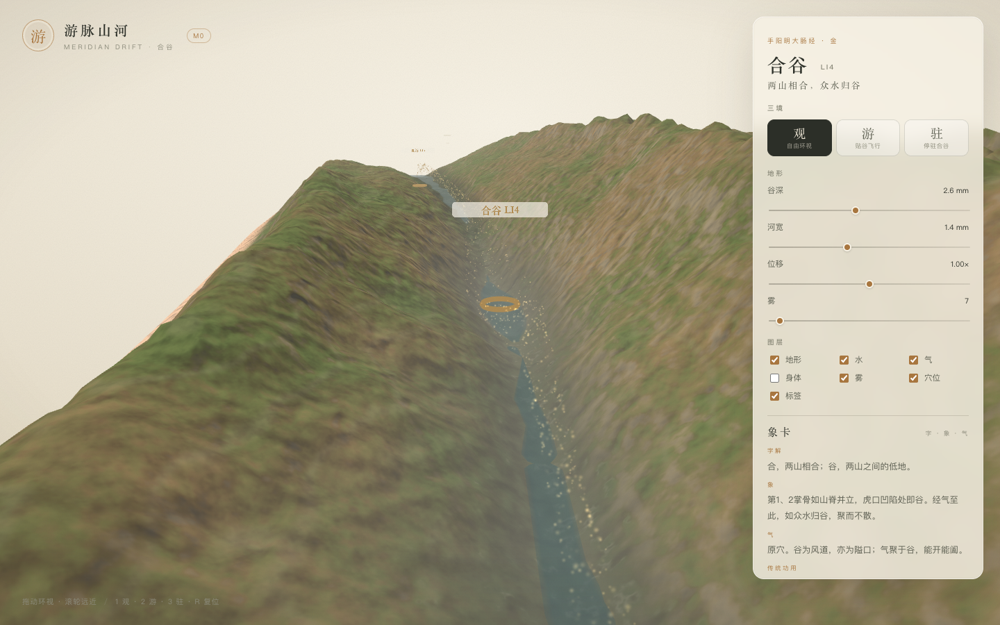
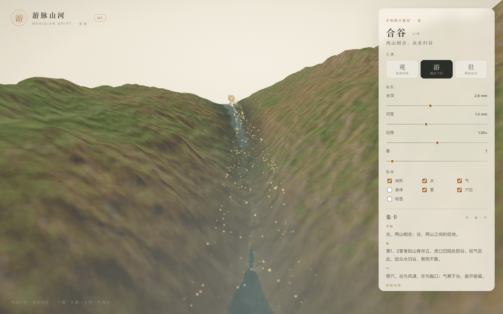
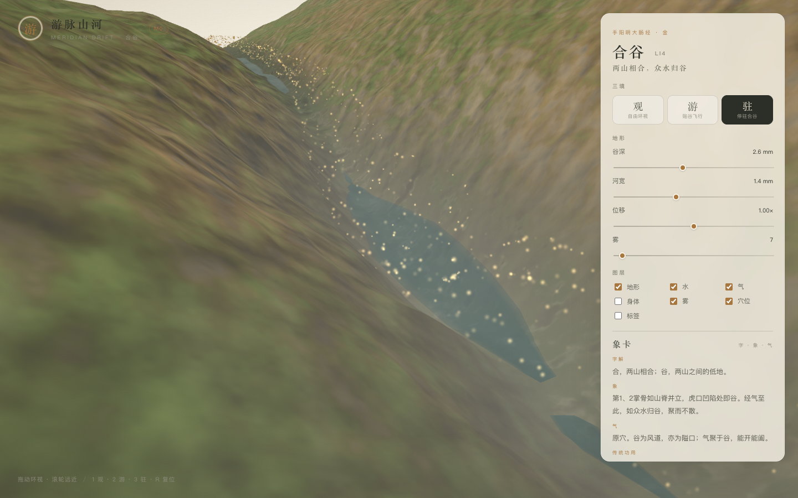

# 游脉山河 · M1 增量：气与象卡

> M0 解决了「看见一个谷」；M1 开始解决「气在谷里怎么走，人怎么知道自己走到了哪一穴」。

- 状态：已完成并部署（2026-11-03）
- 范围：手阳明大肠经合谷段（三间 → 阳溪）
- 入口：<https://yunhenk.github.io/inner-travel/>

| 观 | 游 | 驻 |
| --- | --- | --- |
|  |  |  |

---

## 1. 气粒子

### 路径烘焙

`packages/scene-gen/src/qi/path.ts` 把走廊谷底中线烘焙成一张 `512 × 4` 的 RGBA float 纹理：

| 行 | 内容 | 用途 |
| --- | --- | --- |
| 0 | 世界坐标 | 粒子位置 |
| 1 | 法线（≈ +y） | 上下浮动 |
| 2 | 副法线（T × N） | 横向回旋 |
| 3 | 归一化 s | 调试与后续扩展 |

位置来自 `field.pointAt(s, 0)`，整体抬高 0.6mm，正好贴着谷底与潭面。这样粒子不会浮在皮肤高度，也不会穿进地形。

### 着色器

`packages/render/src/qi/QiView.ts`：

- 3000 个 `Points`，属性只有 `aPhase / aSeed / aSpeed / aSize`；
- 顶点着色器按 `fract(aPhase + t · speed · 0.045 · (0.55 + 0.45 · tide))` 采样曲线纹理；
- 合谷附近用高斯权重增大横向回旋（pool swirl），越接近潭心绕得越开；
- 点大小按距离衰减，`uPixelScale = bufferHeight / (2 · tan(fov/2))`，屏幕上限 18px；
- additive 混合、`depthWrite: false`、`depthTest: true`，山脊能正确遮挡粒子。

不进入 CPU 的逐帧积分，因此粒子密度与回放都不随帧率漂移。

### 与场景的关系

| 模式 | 不透明度 |
| --- | --- |
| 观 | 0.42 |
| 游 | 0.80 |
| 驻 | 0.62 |

- 图层新增「气」，可单独关闭；URL 参数 `qi=0` 同样生效。
- 粒子强度由 `tide` 调制；M1 先用固定 0.62，等时辰 UI 接入后改真实值。
- 粒子只覆盖走廊（三间 → 阳溪），不会跑到手指与曲池段。

---

## 2. 象卡随巡游

- `CameraRig.getFocusS()`：游模式返回相机所在弧长，观/驻返回合谷；
- `SceneHost` 每帧取 `route.nearestStop(focusS)`，**只在编码变化时**回调 `onStopChange`；
- React 用 `activeCode` 取 `findPoint`，面板标题、标签与象卡整体切换；
- 面板短标签：

| 穴位 | 短标签 |
| --- | --- |
| 商阳 LI1 | 一线初泉 |
| 三间 LI3 | 碎石浅溪 |
| 合谷 LI4 | 两山相合，众水归谷 |
| 阳溪 LI5 | 两筋如峡 |
| 曲池 LI11 | 大河回旋 |

卡片正文仍完全来自 内容 JSON（字解 / 象 / 气 / 传统功用 / 典据），没有写进组件。飞到阳溪时，标题会变成「阳溪 LI5」，字解、象、气同步更新。

---

## 3. 顺带修掉的端头问题

气粒子让「走廊端头」暴露得更明显，这次一起处理：

1. **湿边收口**：走廊两端地形摊平，湿边会突然变宽。`buildRiver` 现在把湿边夹到 ±4.5mm，并在最后 1.2cm 用 smoothstep 收口。
2. **水面端头淡出**：水面 shader 按 `vUv.x` 在两端淡出，避免出现悬空水膜。
3. **飞行留边**：游的起止从「±8mm」改为「起点 +2cm、终点 -3cm」，相机不会贴着走廊切边掉头；前瞻点也随之留在谷内。

---

## 4. 验证

| 项 | 结果 |
| --- | --- |
| `pnpm typecheck` | 通过 |
| `pnpm test` | 19 项通过（新增 4 项气路径测试） |
| `pnpm build` | 通过 |
| 线上 | <https://yunhenk.github.io/inner-travel/>，Actions 构建 + 部署成功 |
| 性能 | 3000 点、一张 32KB 曲线纹理，无 CPU 逐帧积分；无头 SwiftShader 下 15–18fps |

新增单测：

- 纹理尺寸与数据完整、全部有限；
- 位置等于 `pointAt(s,0) + 0.6mm`；
- 法线/副法线单位正交；
- 合谷位于路径中段，同参数逐字节一致。

---

## 5. 已知取舍与下一步

- 潮位固定 0.62，尚未接真实时辰与「潮 / 流 / 息」；
- 还未实现按住候气（粒子汇聚、水面扰动、涟漪）；
- 粒子只在走廊内，尚未覆盖整条经与手指；
- 没有粒子 LOD，移动端需要降采样；
- 无音频。

下一步仍然是 M1 的主干：GLB 手部与 20 穴、6 个原型、xstate 巡游、Worker 缓存、DOF/Ink 后处理。

---

## 6. 相关文档

- [设计文档](01-设计文档.md)
- [实现架构](02-实现架构.md)
- [取象词典](03-取象词典.md)
- [M0 实现说明](04-M0实现说明.md)
- [代码目录说明](05-代码目录说明.md)
- [README](../README.md)
