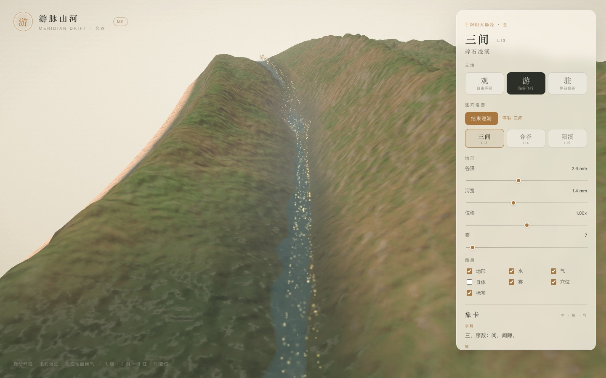

# 游脉山河 · M1 增量：逐穴巡游

> 气会流动了，也能按住候气了；这次让相机自己走完合谷段的三站，并在每一站停下来读象卡。

- 状态：已完成并部署（2026-11-03）
- 范围：三间 LI3 → 合谷 LI4 → 阳溪 LI5
- 线上：<https://yunhenk.github.io/inner-travel/>（右侧「逐穴巡游」）



---

## 1. 状态机

用 `xstate` 写了一个只负责「顺序与停留」的状态机（`apps/web/src/journey/tourMachine.ts`）：

```text
idle ──START / SELECT──► moving ──ARRIVED──► holding
                             ▲                  │
                             │   after 3.6s     │
                             └──────────────────┘
holding（最后一站）──after 3.6s──► finished
任意状态 ──STOP──► idle
```

| 状态 | 含义 |
| --- | --- |
| `idle` | 未开始；点站点可从任意一站开始 |
| `moving` | 相机沿弧长滑向目标站，到位后由 SceneHost 发 `ARRIVED` |
| `holding` | 停在站点，象卡翻到当前穴位；3.6s 后自动去下一站 |
| `finished` | 停在阳溪，等待「再巡一次」或切换三境 |

状态机只做顺序与停留，不直接碰 three；相机运动、到达判定、象卡更新仍由 `SceneHost` / React 负责。

---

## 2. 相机怎么停靠

`CameraRig` 增加了三个方法：

- `beginTour()`：进入逐穴模式，不再乒乓往返；
- `goTo(s)`：设置目标弧长，按 1.6cm/s 滑过去；
- `consumeTourArrival()`：到位后返回一次 `true`，SceneHost 用它给状态机发 `ARRIVED`。

两个细节：

1. **端头留边**：三间加 4mm、阳溪减 8mm，避免相机压在走廊切边上；
2. **末站回望**：目标进入走廊最后 2cm 时，前瞻方向改为向谷内回望，阳溪不会对着地形边缘。

---

## 3. 界面

右侧面板新增「逐穴巡游」：

- **开始巡游 / 结束巡游 / 再巡一次**；
- 三个站点 chip：三间、合谷、阳溪，当前站高亮，点击可直接跳站；
- 状态文字：`前往 合谷` / `停驻 三间` / `巡游完成`；
- 巡游期间三境自动切到「游」；点击观/驻、或按 1/3 会先停止巡游，再切回对应机位。

---

## 4. 测试与验证

| 项 | 结果 |
| --- | --- |
| `pnpm typecheck` | 通过 |
| `pnpm test` | 22 项通过（新增 3 项状态机测试） |
| `pnpm build` | 通过 |
| 线上 | Actions 构建 + 部署成功 |

新增测试覆盖：

- 从 `idle` 开始进入 `moving`，索引为 0；
- 收到 `ARRIVED` 进入 `holding`，`SELECT` 可跳到任意站；
- 任意进行态 `STOP` 回到 `idle`。

浏览器实测：开始巡游 → 三间停驻 → 合谷 → 阳溪 → `巡游完成`，象卡与镜头同步变化；点击站点可直接跳站。

---

## 5. 已知取舍

- 只巡游走廊内三站；商阳 LI1 与曲池 LI11 在走廊外，暂不参与。
- 没有暂停/续播，也没有拖动进度条；停止后从头开始。
- 巡游速度固定，未按五输阶段变速。
- `finished` 会停在阳溪；要用观/驻或切站离开。
- 三境模式目前仍是 React state，xstate 只管巡游；把模式也并入状态机是后续整理项。

---

## 6. 下一步

- 6 个场景原型（溪、峡、池等）真正体现在地形上；
- GLB 手部与 20 穴锚点（需要先解决资产）；
- Worker 生成与缓存；
- DOF / Ink 后处理。

---

## 7. 相关文档

- [设计文档](01-设计文档.md)
- [实现架构](02-实现架构.md)
- [取象词典](03-取象词典.md)
- [M0 实现说明](04-M0实现说明.md)
- [代码目录说明](05-代码目录说明.md)
- [M1 增量：气、象卡与候气](06-M1-气与象卡.md)
- [README](../README.md)
