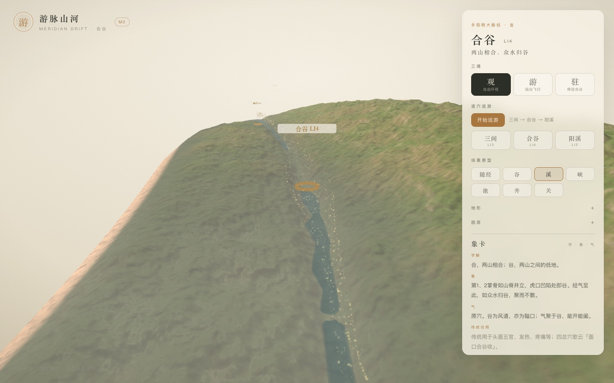
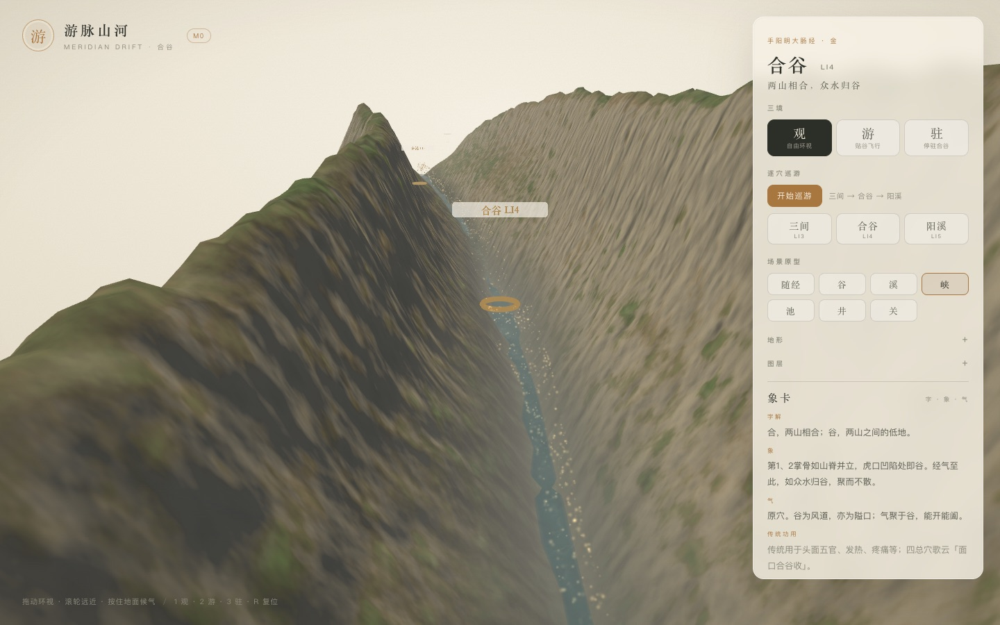
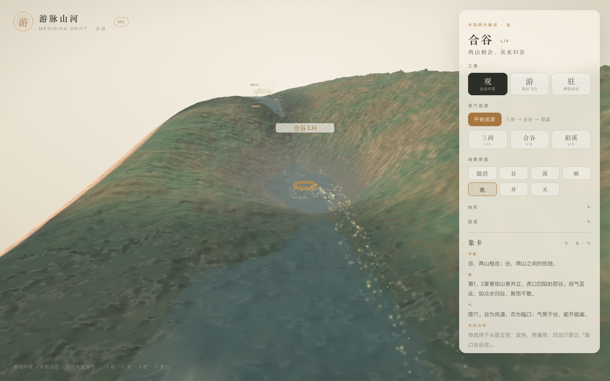

# 游脉山河 · M1 增量：六个场景原型

> 同一段走廊，应该能是溪、是谷、是峡，也可以是池、井、关。
> 这次把「原型」从取象词典里的名词，变成地形参数与可切换的预览。

- 状态：已完成并部署（2026-11-03）
- 范围：合谷走廊（三间 → 阳溪）
- 线上：<https://yunhenk.github.io/inner-travel/>（右侧「场景原型」）

| 溪 | 峡 | 池 |
| --- | --- | --- |
|  |  |  |

---

## 1. 六个原型

| 原型 | 关键参数 | 观感 |
| --- | --- | --- |
| 谷 `valley` | 基准：谷深 3mm、脊距 7.8mm、潭 5.5×3.4mm | 两山相合，溪流归潭 |
| 溪 `stream` | 谷浅而宽、河窄且深、潭缩小、细节多 | 碎石浅滩，水在卵石间穿行 |
| 峡 `gorge` | 谷深 1.35×、脊距 5.2mm、河窄 0.65× | 两壁夹水，谷底幽深 |
| 池 `pool` | 谷浅、潭深 2.6×、潭面 9×6.5mm | 水面铺开，像一块静水 |
| 井 `well` | 谷浅、潭深 3.2×、潭面 4×3mm | 小而深的圆井 |
| 关 `pass` | 脊距 4.5mm、脊高 1.2×、河窄 | 两山紧锁，只留一线 |

参数在 `packages/scene-gen/src/corridor/archetypes.ts`：

```ts
interface ArchetypeParams {
  valleyAmp; ridgeOffset; sigmaC; sigmaR; ridgeGain;
  riverWidth; riverDepth; waterLevel;
  poolDepth; poolSigmaS; poolSigmaT; poolLevel;
  detail; secondary;
}
```

它们直接参与 `TerrainField.displacementAt`，并影响水域宽度、潭面高度与调色板；不是只换一张色纸。

---

## 2. 随经混合

默认 `archetype: 'auto'`，以两个高斯权重在三站之间平滑过渡：

- 三间（s≈0.068）→ **溪**
- 合谷（s≈0.108）→ **谷**
- 阳溪（s≈0.157）→ **峡**

| 位置 | 谷深 | 脊距 | 河宽 |
| --- | --- | --- | --- |
| 三间 | 0.6× | 10.5mm | 0.9× |
| 合谷 | 1.0× | 7.8mm | 1.0× |
| 阳溪 | 1.35× | 5.2mm | 0.65× |

于是逐穴巡游会自然从「浅溪」走到「谷」，再走进「峡」；这也是 M1 里第一次让同一条走廊出现形态变化。

---

## 3. 水域也跟着变

原型的差异不只在山，也在水：

- `waterLevel` 控制河道水面相对谷底的抬升（溪 0.12mm → 峡 0.22mm）；
- `poolLevel` 控制潭面相对潭心的抬升，避免浅潭水漫过整片谷底；
- 水带宽度以 `poolSigmaT × 0.6` 封顶，避免深潭/浅滩在近景铺成一块过大的水膜；
- 端头仍保留收口与淡出（见 [06](06-M1-气与象卡.md)）。

---

## 4. 预览工具

右侧面板新增「场景原型」：

- 「随经」= 自动混合；
- 谷 / 溪 / 峡 / 池 / 井 / 关 = 固定原型预览；
- 切换后只重建地形、水、气路径与标记，相机与巡游状态保留；
- URL 参数：`?archetype=gorge`，方便分享与截图。

为了给象卡留出空间，「地形」与「图层」两组控件改为默认折叠，点标题展开。这是 M1 的预览工具形态，不是最终的信息架构。

---

## 5. 验证

| 项 | 结果 |
| --- | --- |
| `pnpm typecheck` | 通过 |
| `pnpm test` | 27 项通过（新增 5 项原型测试） |
| `pnpm build` | 通过 |
| 线上 | Actions 构建 + 部署成功 |

新增测试：

- 六个原型与「随经」选项齐全；
- 随经在三间/合谷/阳溪分别为溪/谷/峡的参数；
- 峡比谷更窄更深，溪比谷更宽更浅；
- 六个固定原型都能生成合法地形，谷底低于山脊；
- 同参数原型生成结果确定。

---

## 6. 已知取舍

- 固定原型是**预览工具**：池、井、关目前会把整段走廊变成该原型，不代表最终会放在这些穴位上；
- 随经只覆盖走廊内三站，商阳（井）与曲池（池）仍在走廊外；
- 溪的浅滩在近景仍会出现较宽的水面与锯齿状岸线，后续需要更细的湿边与岸线融合；
- 井与关的夸张程度偏高，等扩到前臂/肘部后会重新按真实解剖收敛；
- 原型参数目前写在代码里，尚未落到 `content/archetypes/*.json`。

---

## 7. 下一步

- GLB 手部与 20 穴锚点（需要先解决资产）；
- 地形生成迁 Worker + IndexedDB 缓存；
- DOF / Ink / Paper 后处理；
- 把原型默认值搬进 `content/archetypes`，支持按穴位引用。

---

## 8. 相关文档

- [设计文档](01-设计文档.md)
- [实现架构](02-实现架构.md)
- [取象词典](03-取象词典.md)
- [M0 实现说明](04-M0实现说明.md)
- [代码目录说明](05-代码目录说明.md)
- [M1：气、象卡与候气](06-M1-气与象卡.md)
- [M1：逐穴巡游](07-M1-逐穴巡游.md)
- [README](../README.md)
