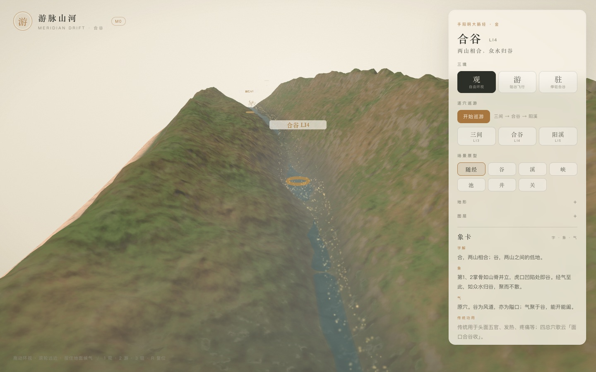

# 游脉山河 · M1 增量：地形墨洗与纸感

> 墨应该长在山里，而不是盖在画面上。
> 这次把墨洗与纸纹做进地形材质，标签和 UI 保持干净。

- 状态：已完成并部署（2026-11-03）
- 范围：合谷走廊地形
- 线上：<https://yunhenk.github.io/inner-travel/>



---

## 1. 先试了屏幕空间，然后回退

一开始做的是 EffectComposer + 亮度 Sobel 的 InkPass，想一次性做「墨线 + 纸纹 + 暗角」。实际截图里：

- 亮度边缘把地形的高频颗粒全部勾出来，山体变成一层噪点；
- 穴位标签是 canvas sprite，文字边缘也被 Sobel 反复描边，出现灰边和毛刺；
- 半浮点 + OutputPass 之后，整体颜色偏灰，FPS 也从 13 掉到 6（SwiftShader）。

这不是「墨」，是压缩伪影。与其硬上，不如把墨限制在地形上。**屏幕空间版本已回退**，没有留在代码里。

---

## 2. 墨洗做进地形材质

在 `packages/render/src/terrain/terrainMaterial.ts` 里加了三笔：

| 笔触 | 做法 |
| --- | --- |
| 山脊/轮廓 | Fresnel：`pow(1 - dot(n, viewDir), 3)`，沿视线边缘压墨 |
| 陡坡皴擦 | `slope × fbm(world.xz)` 的稀疏 hatch，只在高坡度出现 |
| 谷底积墨 | 原有的 `aConcavity`，低洼处加深 |
| 纸纹 | `hash21(gl_FragCoord)` 的 3% 明暗扰动，只作用于地形 |

核心几行：

```glsl
float rim = pow(1.0 - clamp(dot(n, viewDir), 0.0, 1.0), 3.0);
float hatch = smoothstep(0.58, 0.92, slope)
            * smoothstep(0.42, 0.78, fbm(vWorld.xz * 520.0 + vWorld.y * 700.0));
col = mix(col, uInk, uInkBoost * (rim * 0.2 + hatch * 0.14));
```

`uInkBoost` 与 `uInkStrength` 由 `TerrainView.setInk()` 控制，默认开启。

---

## 3. 开关

图层里新增「墨」：

- 开：轮廓、陡坡皴擦、谷底积墨都保留；
- 关：`uInkBoost = 0`、`uInkStrength = 0`，回到干净地形；
- 纸纹是地形的轻微质感，不随「墨」关闭，避免开关时画面突然变塑料。

因为只改地形材质，标签、穴位环、水面、气粒子、UI 都不受影响，也没有新增 render target 或全屏 pass，性能与之前一致。

---

## 4. 验证

| 项 | 结果 |
| --- | --- |
| `pnpm typecheck` | 通过 |
| `pnpm test` | 28 项通过 |
| `pnpm build` | 通过 |
| 截图 | 观/游/驻/巡游/候气/原型全部重新生成 |
| 标签 | 文字边缘干净，无屏幕空间后处理的毛刺 |
| 性能 | 仍是单次前向渲染 + 自定义地形材质，无 composer |

---

## 5. 已知取舍

- 这是**地形墨洗**，不是屏幕空间墨线；山体与天空/水面的轮廓不会整体描边；
- 陡坡 hatch 用世界坐标 fbm，不同尺度下密度会变化；
- 纸纹不随「墨」开关，属于常驻质感；
- 真正的 DOF 与全屏墨线仍需要 depth/normal pass，以及把标签移到 post 之后单独渲染。

---

## 6. 下一步

- 若继续做屏幕空间：先加 depth + normal 双 pass，并给标签/穴位环单独做 overlay；
- DOF 聚焦合谷/当前站点，光圈与微距景深要非常克制；
- GLB 手部与 20 穴；
- 把原型/墨洗参数搬进 `content/`。

---

## 7. 相关文档

- [设计文档](01-设计文档.md)
- [实现架构](02-实现架构.md)
- [取象词典](03-取象词典.md)
- [M0 实现说明](04-M0实现说明.md)
- [代码目录说明](05-代码目录说明.md)
- [M1：气、象卡与候气](06-M1-气与象卡.md)
- [M1：逐穴巡游](07-M1-逐穴巡游.md)
- [M1：场景原型](08-M1-场景原型.md)
- [M1：Worker 与缓存](09-M1-Worker与缓存.md)
- [README](../README.md)
