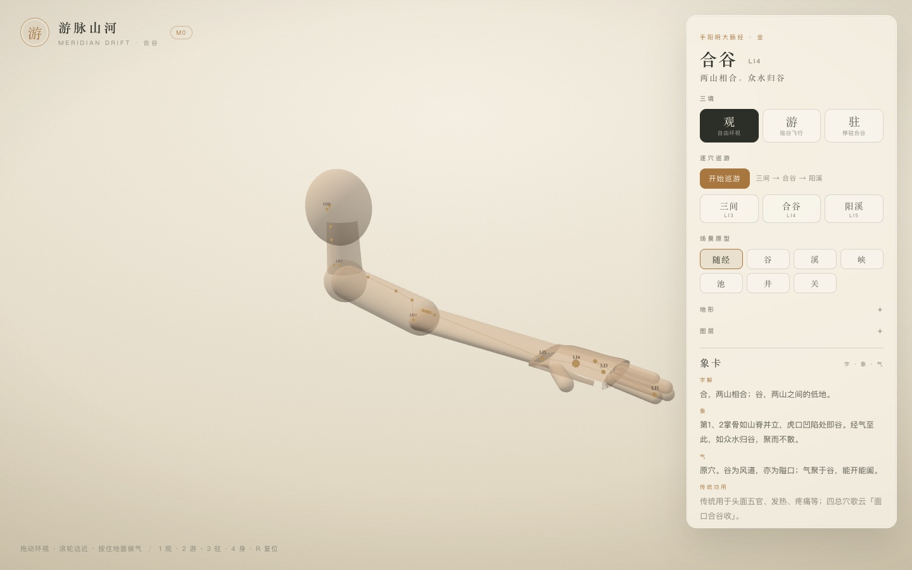

# 游脉山河 · M1 增量：二十穴与全身示意

> 先把二十个穴位放到同一条手臂上，再谈 GLB。
> 这一版是程序化身体的锚点总览，不是最终骨骼绑定。

- 状态：已完成并部署（2026-11-03）
- 范围：手阳明大肠经 20 穴
- 线上：<https://yunhenk.github.io/inner-travel/>（图层 → 全身）

---

## 1. 这一版做了什么

- 给程序化身体补了 **颈 + 头**，让 LI17–LI20 有落点；
- 补了 `upperarm.R / shoulder.R / neck.R / head.R` 四个帧；
- 20 个穴位全部能 `resolveAnchor` 到世界坐标；
- 新增「全身」总览：
  - 相机拉到手臂全景，地形/水/气/雾/穴位标记暂时隐藏；
  - 身体半透明，20 个锚点连成一条经线；
  - LI1 / LI3 / LI4 / LI5 / LI11 / LI15 / LI20 显示穴码，其余为点；
  - 当前站点（合谷）的点会放大。
- 入口：
  - 图层 → 全身
  - 键盘 `4`
  - URL `?overview=1`

---

## 2. 锚点分布

| 区段 | 帧 | 穴位 | 状态 |
| --- | --- | --- | --- |
| 手 | `hand.R` | LI1–LI5 | 已标定 |
| 前臂 | `forearm.R` | LI6–LI11 | 已标定 |
| 上臂 | `upperarm.R` | LI12–LI14 | 已标定 |
| 肩 | `shoulder.R` | LI15–LI16 | 已标定 |
| 颈 | `neck.R` | LI17–LI18 | 示意 |
| 头 | `head.R` | LI19–LI20 | 示意 |

- 16 个已标定（`anchorStatus: authored`）；
- 颈/头 4 个仍是 `placeholder`：程序化头颈只是示意体块，等 GLB 后按骨骼矩阵重标；
- 所有坐标都在 `content/meridians/hand-yangming-large-intestine.json`，渲染层不写死穴位位置。

---

## 3. 身体与相机

- 程序化身体原本已有手掌、五指、前臂、上臂、肩球；这次补了：
  - 颈：圆柱；
  - 头：椭球；
  - 肩球从上臂 mesh 的子节点移到世界坐标，修掉二次变换造成的「漂浮球」。
- 总览相机固定在 `(0.34, 0.30, 0.62)`，看向 `(-0.17, 0.08, 0.015)`；
- 总览时把雾密度从 7 降到 0.45，否则 0.8m 的视距会整片糊成纸色；
- 退出总览恢复原模式、原雾密度与原图层可见性。

---

## 4. 锚点渲染

- 点：`SphereGeometry(0.0028)`，`depthTest: false`，保证被手臂挡住的后侧穴位也能看到；
- 经线：按 LI1 → LI20 顺序连成 `Line`；
- 标签：只给 7 个关键穴显示穴码，避免 20 个标签在前臂上叠成一团；
- 当前站点由 `setActive` 放大 1.9×。

---

## 5. 验证

| 项 | 结果 |
| --- | --- |
| `pnpm typecheck` | 通过 |
| `pnpm test` | 30 项通过（新增 2 项锚点测试） |
| `pnpm build` | 通过 |
| 总览进入/退出 | 雾 7→0.45→7；地形/水/气隐藏→恢复；锚点显示→隐藏 |
| 截图 | `body20.jpg` |
| 线上 | 图层「全身」可切换，键盘 `4` 可切换 |

新增测试：

- 20 个锚点都能解析为有限世界坐标；
- 16 个已标定、4 个颈/头示意。

---

## 6. 已知取舍

- **不是 GLB 骨骼绑定**：仍是程序化身体 + 世界坐标锚点；换 GLB 后需要按骨骼矩阵重算；
- 头/颈是示意体块，LI17–LI20 的位置只保证「在颈/头附近」，不是解剖精确点；
- 全身视角是固定机位，不能环绕；它用于总览，不替代观/游/驻；
- 只给 7 个关键穴显示标签，其余靠点与文档；
- 锚点 `depthTest: false`，背面的点也会透出来，这是总览的有意取舍。

---

## 7. 下一步

- 接入带骨骼的手/臂 GLB，把 `frameToWorld` 换成骨骼矩阵；
- 20 穴全部显示标签 / 引线，并支持点击切换象卡；
- 颈/头锚点按真实解剖重新标定；
- 真正的屏幕空间 DOF 仍排在后面。

---

## 8. 相关文档

- [设计文档](01-设计文档.md)
- [实现架构](02-实现架构.md)
- [取象词典](03-取象词典.md)
- [M0 实现说明](04-M0实现说明.md)
- [代码目录说明](05-代码目录说明.md)
- [M1：气、象卡与候气](06-M1-气与象卡.md)
- [M1：逐穴巡游](07-M1-逐穴巡游.md)
- [M1：场景原型](08-M1-场景原型.md)
- [M1：Worker 与缓存](09-M1-Worker与缓存.md)
- [M1：地形墨洗与纸感](10-M1-地形墨洗与纸感.md)
- [README](../README.md)
