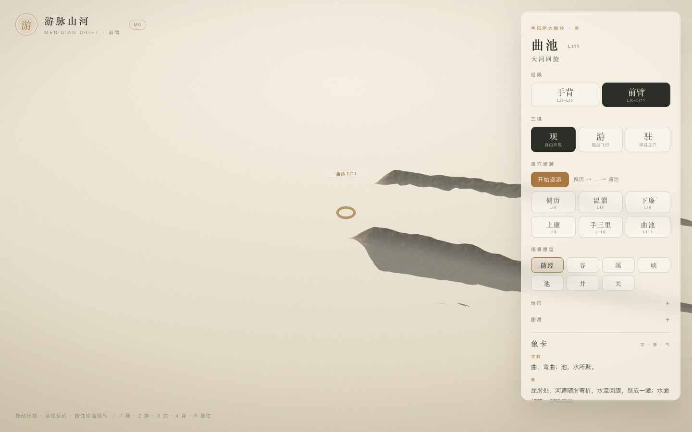
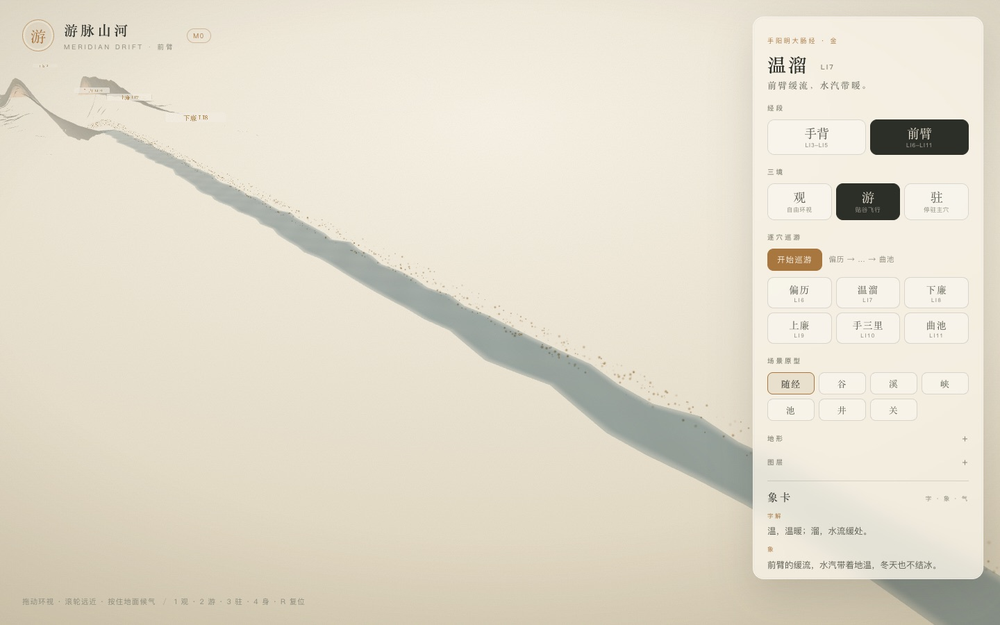

# 游脉山河 · M1 增量：前臂段 LI6–LI11

> 历史阶段：分段方案，已被 [焦点窗口连续手臂](14-M1-焦点窗口连续手臂.md) 取代。
>
> 从手背走到前臂。现在可游的不再只有三间、合谷、阳溪三穴，而是两段共 9 个穴。

- 状态：已完成并部署（2026-11-03）
- 范围：手背 LI3–LI5 + 前臂 LI6–LI11
- 线上：<https://yunhenk.github.io/inner-travel/>（经段 → 前臂）

| 观（前臂） | 游（前臂） |
| --- | --- |
|  |  |

---

## 1. 现在有什么

- 新增「经段」选择：
  - 手背：LI3 三间 → LI4 合谷 → LI5 阳溪
  - 前臂：LI6 偏历 → LI7 温溜 → LI8 下廉 → LI9 上廉 → LI10 手三里 → LI11 曲池
- 逐穴巡游从前臂段的 LI6 走到 LI11，共 6 站；状态机的站数从固定 3 改为事件携带的 `total`。
- URL：`?segment=forearm`
- 手背段保持原来的观/游/驻与三站巡游；前臂段有自己的相机、地形与卡片。

累计可游穴位：**9 个**（LI3–LI11），内容/锚点仍是 20 穴。

---

## 2. 前臂地形怎么接

没有把整条前臂包成圆柱，而是把**桡侧切平面**展开成走廊：

```text
x = 曲线在 s 处的 x（沿前臂）
y = forearmRadii(x).z + 位移（径向朝上）
z = t（横向）
```

- 手背段仍用 `palmDorsalY(x,z)`，前臂段用 `forearmRadii` 的径向半径作为基面；
- 前臂身体整体绕 X 轴转 -90°，让桡侧朝上；地形只取切平面，边缘允许毫米级悬空；
- 法线统一翻成朝上，修掉前臂段整体发灰的问题；
- 水、气、标记、相机都复用同一套 y-up 代码。

代码上把 `TerrainField` 的固定合谷域抽成 `TerrainSegment`：

```ts
{ surface: 'forearm', s0, s1, focusS, autoS, tMin, tMax, ridgeOffset }
```

`buildOptions()` 按经段生成，Worker/缓存 key 也随 segment 变化。

---

## 3. 相机

- 手背：保持原 2.4cm 的贴谷机位；
- 前臂：观视角抬到侧上方 `(0.008, 0.022, 0.028)`，先看曲池附近；游的相机抬到 `+0.009y / +0.011z`，避免贴着切平面飞；
- 驻留在主穴（前臂为曲池）。

前臂比手掌长（约 18.6cm），一次只能看一段；要看完整段用「游」或逐穴巡游。

---

## 4. 验证

| 项 | 结果 |
| --- | --- |
| `pnpm typecheck` | 通过 |
| `pnpm test` | 31 项通过（新增 6 站巡游测试） |
| `pnpm content:validate` | 0 错误；4 个颈/头锚点仍为示意 |
| `pnpm build` | 通过 |
| 经段切换 | 手背 ↔ 前臂可切，宿主重建、巡游重置、站点从 3 变 6 |
| 前臂巡游 | LI6 起步，按 3.6s 停留继续 |
| 线上 | 待部署后验证 |

---

## 5. 已知取舍

- 前臂是**切平面走廊**，不是完整圆柱包裹；边缘会与身体有几毫米悬空；
- 前臂横截面窄，观视角仍以局部为主，完整段要靠游/巡游；
- 前臂地表目前偏灰、偏干，和手背的苔绿不一致；下一轮会调前臂调色板与光照；
- 只做到 LI11；LI1/LI2 手指段、LI12–LI20 上臂/肩/颈/头还没进入微地形；
- 身体仍是程序化基座，不是 GLB；20 穴锚点为世界坐标。

---

## 6. 下一步

- 补 LI1–LI2 手指段（食指末端与二间）；
- 上臂/肩/颈/头段（LI12–LI20），或先做 GLB 骨骼；
- 前臂调色板与更自然的圆柱包裹；
- 屏幕空间 DOF 继续排在后面。

---

## 7. 相关文档

- [设计文档](01-设计文档.md)
- [实现架构](02-实现架构.md)
- [取象词典](03-取象词典.md)
- [M0 实现说明](04-M0实现说明.md)
- [代码目录说明](05-代码目录说明.md)
- [M1：气、象卡与候气](06-M1-气与象卡.md)
- [M1：逐穴巡游](07-M1-逐穴巡游.md)
- [M1：场景原型](08-M1-场景原型.md)
- [M1：Worker 与缓存](09-M1-Worker与缓存.md)
- [M1：地形墨洗与纸感](10-M1-地形墨洗与纸感.md)
- [M1：二十穴与全身示意](11-M1-二十穴与全身示意.md)
- [README](../README.md)
