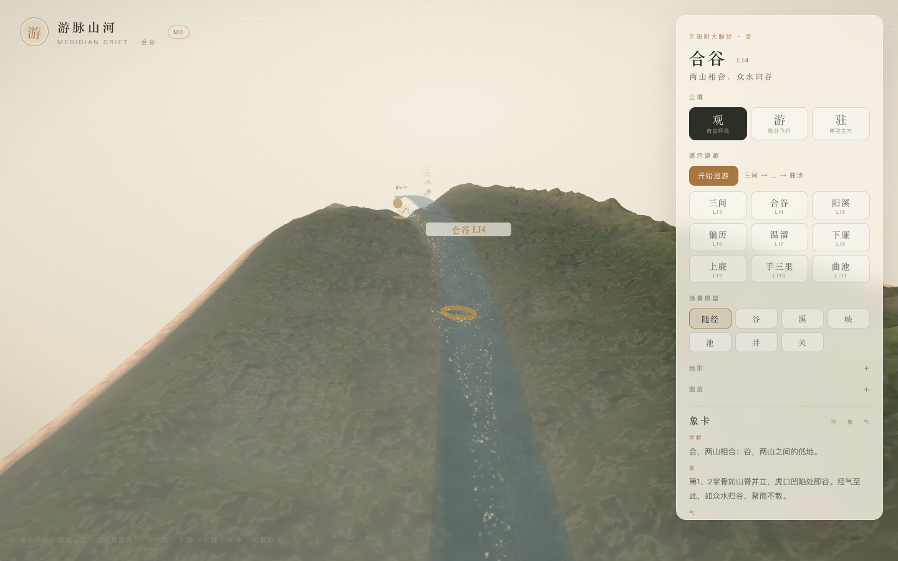

# 游脉山河 · M1 增量：焦点窗口连续手臂

> 一条 LI3–LI11 的连续经，一次加载，一个场景。
> 只生成相机附近的地形窗口，远处降级为经线与穴位点。

- 状态：Phase 1+2 原型已完成（2026-11-03）
- 范围：手阳明大肠经 LI3–LI11，共 9 穴
- 线上：<https://yunhenk.github.io/inner-travel/>



---

## 1. 这次解决了什么

### 之前

- 手背 / 前臂是两个经段，点击要销毁重建整个 `SceneHost`；
- 整臂连续高模在腕部立成 90° 峭壁；
- 换段加载久，且不是同一场景。

### 现在

- 一条 route：LI3 → LI11，9 站；
- 一个 `SceneHost`、一个 WebGL 上下文、一次初始加载；
- 只构建焦点 ±5cm 的走廊窗口；
- 窗口外只有 ArmLine 经线 + 穴位点（L2）；窗口两端加横向雾软化切边；
- 窗口随巡游/飞行滑动，异步换入，不重建场景；
- 相机 `up` 跟随焦点局部法线，腕部不再出现整臂高模峭壁。

---

## 2. 结构

```text
route (LI3–LI11)
  ├─ fullField      相机 / 法线 / 路径查询
  ├─ WindowTracker  焦点窗口（5mm 吸附，3.5cm 半宽，12mm 缓冲）
  ├─ windowField    当前窗口的 TerrainField
  ├─ corridor       当前窗口的地形/水/气/雾/标记
  └─ ArmLine        整条经线 + 9 个穴位点（远处 L2）
```

- `pointAt = surfaceFrame + normal * displacement`
- `waterPointAt = surfaceFrame + normal * waterOffset`
- 手背用 `palmDorsalY`，前臂用 `ry/rz` 椭圆截面；腕部法线在 3cm 内过渡；
- 相机 `up` 在 fly 时跟局部法线，观察手背时仍是 y-up；窗口外没有整臂高模，因此不会看到峭壁。

---

## 3. 窗口与加载

- 初始窗口：合谷 ±5cm；
- 焦点移动超过约 2.3cm 时换窗口；
- 窗口参数按 5mm 量化，Worker + IndexedDB 缓存可直接命中；左右相邻窗口在换窗后预生成；
- 窗口生成期间保留旧窗口，不阻塞输入；
- 当前窗口约 3.5 万三角形，低于整臂高模的 16.7 万。

---

## 4. 验证

| 项 | 结果 |
| --- | --- |
| `pnpm typecheck` | 通过 |
| `pnpm test` | 37 项通过（新增 3 项连续手臂/窗口测试） |
| `pnpm content:validate` | 0 错误，4 个颈/头锚点仍为示意 |
| `pnpm build` | 通过 |
| 初始窗口 | 手背地形 + 远处经线，无前臂峭壁 |
| 巡游 | LI3–LI11 共 9 站；窗口随焦点滑动 |
| 窗口外 | 只保留 ArmLine 与穴位点 |

---

## 5. 已知取舍

- 这是**单窗口**，不是完整 tile 管理器；边界用 dither dissolve 软化，但仍不是真正的 skirt；
- 水面仍偏宽，窗边 dissolve 只是软化，不是真正的 skirt；
- 窗口换入时远处标签会短暂保留（ArmLine 只隐藏焦点附近点）；
- 初始冷启动仍有 shader 编译与首窗口生成，加载遮罩可能停留 1–2 秒；
- 身体仍是程序化基座，GLB 与全身多经尚未接；
- DOF/屏幕空间墨线仍未做。

---

## 6. 下一步

1. 多 tile：窗口边缘预生成相邻 tile，做 skirt/交叉淡入，去掉切边；
2. 远景 L2 只留经线，隐藏窗口外标签；
3. 多经图：同一 BodySurface 上的 MeridianGraph；
4. GLB 骨骼/蒙皮与全身 LOD；
5. 最后再上 DOF/墨线。

---

## 7. 相关文档

- [设计文档](01-设计文档.md)
- [实现架构](02-实现架构.md)
- [取象词典](03-取象词典.md)
- [M0 实现说明](04-M0实现说明.md)
- [代码目录说明](05-代码目录说明.md)
- [M1：气、象卡与候气](06-M1-气与象卡.md)
- [M1：逐穴巡游](07-M1-逐穴巡游.md)
- [M1：场景原型](08-M1-场景原型.md)
- [M1：Worker 与缓存](09-M1-Worker与缓存.md)
- [M1：地形墨洗与纸感](10-M1-地形墨洗与纸感.md)
- [M1：二十穴与全身示意](11-M1-二十穴与全身示意.md)
- [M1：前臂段（历史）](12-M1-前臂段.md)
- [全身经脉技术方案](13-全身经脉技术方案.md)
- [README](../README.md)
