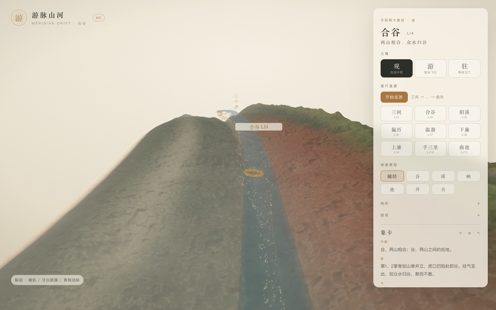

# 游脉山河 · 解剖山体设计

> 不是把山涂成红色，而是让山形来自肌腹、谷来自筋膜、河来自血管。
> 先有解剖分层，再有山水。

- 状态：设计文档 + 小原型（2026-11-03）


- 范围：手阳明大肠经 LI3–LI11 的解剖启发地形
- 原则：原有山水/窗口/巡游全部保留，解剖作为可开关的叠加层

---

## 1. 核心判断

不能从「皮肤高度场 + 噪声」起。真实人体的体表起伏来自：

1. 皮肤与皮纹；
2. 皮下脂肪；
3. 浅/深筋膜；
4. 肌腹与肌腱；
5. 骨性隆起；
6. 血管、神经、淋巴。

所以地形高度应该是**组织厚度的函数**，而不是 fbm 的函数。

```text
H(s,t) = 皮肤基面
       + 脂肪厚度
       + Σ 肌腹隆起
       - 肌间隔 / 筋膜沟
       - 血管沟
       + 肌腱脊
```

位移沿局部法线 `N`，不是世界 y。

---

## 2. 解剖 → 山水映射

| 解剖 | 山水 |
| --- | --- |
| 皮肤、皮纹、汗毛 | 地表、纸纹、草 |
| 皮下脂肪 | 黄土缓坡、柔软山肩 |
| 浅筋膜 | 雾、雪线 |
| 深筋膜 / 肌间隔 | 岩层、断崖、峡谷壁 |
| 肌腹 | 山体、山脊 |
| 肌腱 / 腱膜 | 石脊、栈道、天生桥 |
| 骨 / 骨膜 | 山根、洞窟、石核 |
| 动脉 | 江河主脉 |
| 静脉 | 支流、水网 |
| 神经 / 筋膜链 | 气脉、金色小径 |
| 关节 / 骨缝 | 峡口、隘口 |
| 穴位 | 泉眼、洞天、石门 |

---

## 3. 手阳明大肠经的解剖骨架

### 合谷 LI4

- 第 1、2 掌骨之间，第一骨间背侧肌；
- 两块掌骨是山根，肌腹是山体；
- 骨间膜/肌间隔是谷；
- 手背静脉网是支流；
- 穴位在肌肉与筋膜交汇的凹陷。

### 三间 LI3

- 第 2 掌指关节后方，骨间背侧肌起点；
- 掌骨与肌腹之间的窄谷，碎石浅溪。

### 阳溪 LI5

- 腕桡侧，拇长/拇短伸肌腱之间；
- 两条腱性石脊夹一口峡，下面是桡动脉支流。

### 偏历—手三里 LI6–LI10

- 前臂桡侧，肱桡肌与桡侧腕长/短伸肌之间；
- 肌腹是连续山脊；
- 肌间隔是谷；
- 桡动脉是主河；
- 穴位是肌肉间隙里的渡口。

### 曲池 LI11

- 肱骨外上髁前下方，伸肌总腱附近；
- 肌腱汇合处的回水潭，肘窝是峡口。

---

## 4. 为什么手背到前臂会转 90°

- 手背：伸肌腱、骨间肌，表面朝上；
- 前臂桡侧：肱桡肌、桡动脉、伸肌群，表面朝桡侧；
- 经络从手背绕到前臂桡侧，皮肤法线跟着转。

因此：

- 一张 y-up 高度场，手背平、前臂立；
- 一张跨腕网格可以共享索引，但屏幕投影仍会折；
- 要一张跨腕山水，必须让相机 `up` 跟局部法线滚动，或把皮肤展开成地图。

这不是网格拓扑问题，是解剖表面本来扭转。

---

## 5. 小原型：解剖叠加层

这一版不替换现有地形，只在 `TerrainField` 上叠加一层可开关的解剖启发位移：

- `anatomy: true` 时，在 `displacementAt` 上增加：
  - 手背第一骨间背侧肌的肌腹脊；
  - 前臂肱桡肌 / ECRL / ECRB 的三道肌腹脊；
  - 肌间隔的负高斯沟；
  - 桡动脉走行的浅槽；
- 幅度约 0.2–0.8mm，叠加在现有 3–5mm 山谷上；
- 默认关闭，原有画面不变；
- 面板「图层 → 解剖」开关 + URL `?anatomy=1`；开启后左下角显示「赭肌 / 牙白筋膜 / 青桡动脉」。

### 原型参数（米）

| 结构 | 位置 | 形式 |
| --- | --- | --- |
| 第一骨间背侧肌 | 手背 `t≈0.004` | 沿 `s` 的宽脊 |
| 肌间隔 | 手背 `t≈-0.006` | 窄沟 |
| 肱桡肌 | 前臂 `t≈-0.008` | 纵向脊 |
| ECRL | 前臂 `t≈0` | 纵向脊 |
| ECRB | 前臂 `t≈0.008` | 纵向脊 |
| 桡动脉 | 前臂 `t≈-0.011` | 浅槽/水线 |
| 腕部肌腱 | 腕口 | 短脊 |

这些是**解剖启发的近似**，不是医学精确分割；后续可替换为 GLB/MRI 的肌肉 SDF。

---

## 6. 技术路线

### 近期（本原型，已实现）

1. 在 `packages/scene-gen/src/anatomy/landscape.ts` 里写解剖位移函数；
2. `TerrainField` 增加 `anatomy` 选项，叠加到现有高度场；
3. 面板开关、URL 参数、Worker 缓存 key 同步；
4. 单测：解剖开启后肌腹处更高、肌间隔处更低，确定性。

### 中期

1. 皮肤 + 肌肉 + 骨 + 血管的分层 GLB/MRI；
2. 用 SDF 采样组织厚度，替换程序化近似；
3. 局部标架 + 相机滚动，解决跨腕 90°；
4. 穴位作为筋膜/血管/肌腱交汇的 landmarks。

### 长期

- 全身 12 经 + 8 脉；
- 解剖 LOD：近景皮纹、中景肌腹、远景经络；
- 切开穴位看到下层组织，但保持水墨语言。

---

## 7. 视觉原则

- 不是医学插画，也不是血腥写实；
- 肌肉是赭红/墨红，筋膜是象牙白，骨是石白，血管是青蓝/朱红；
- 皮肤半透明、纸感；
- 气是神经/筋膜链的金色粒子；
- 穴位是洞天，不是红点。

---

## 8. 原型开关

- 面板「图层 → 解剖」；
- URL：`?anatomy=1`；
- 默认关闭，原有地形/巡游/卡片不变。

## 9. 相关文档

- [设计文档](01-设计文档.md)
- [实现架构](02-实现架构.md)
- [取象词典](03-取象词典.md)
- [M0 实现说明](04-M0实现说明.md)
- [代码目录说明](05-代码目录说明.md)
- [M1：气、象卡与候气](06-M1-气与象卡.md)
- [M1：逐穴巡游](07-M1-逐穴巡游.md)
- [M1：场景原型](08-M1-场景原型.md)
- [M1：Worker 与缓存](09-M1-Worker与缓存.md)
- [M1：地形墨洗与纸感](10-M1-地形墨洗与纸感.md)
- [M1：二十穴与全身示意](11-M1-二十穴与全身示意.md)
- [M1：前臂段（历史）](12-M1-前臂段.md)
- [全身经脉技术方案](13-全身经脉技术方案.md)
- [自适应索引网格](14-M1-焦点窗口连续手臂.md)
- [README](../README.md)
